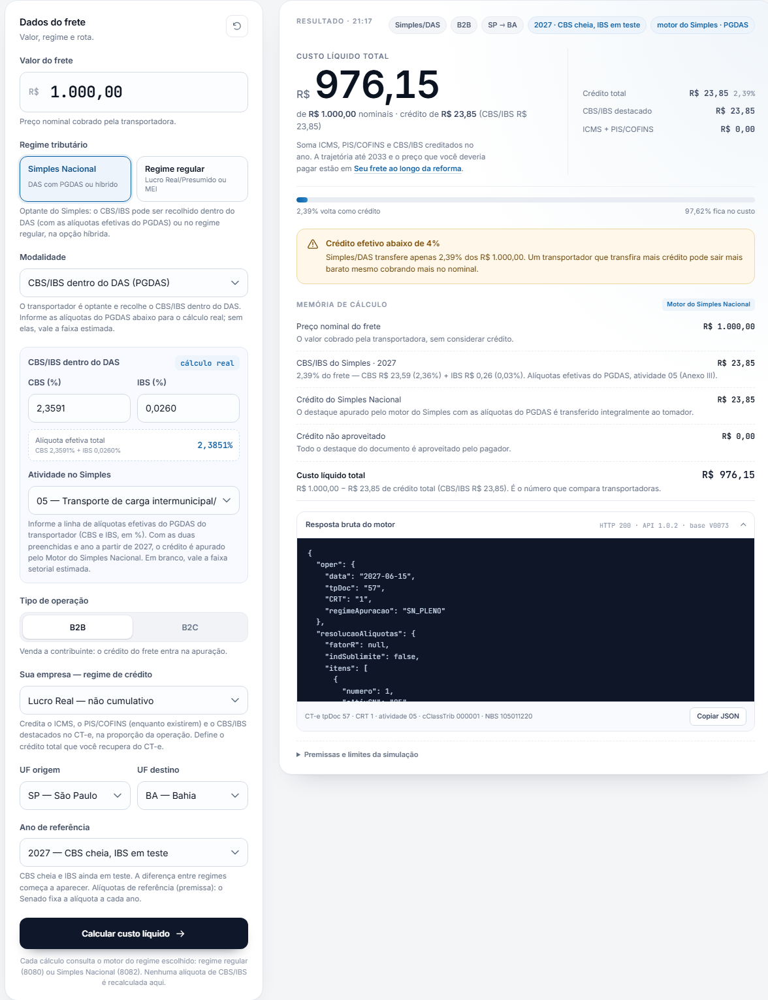
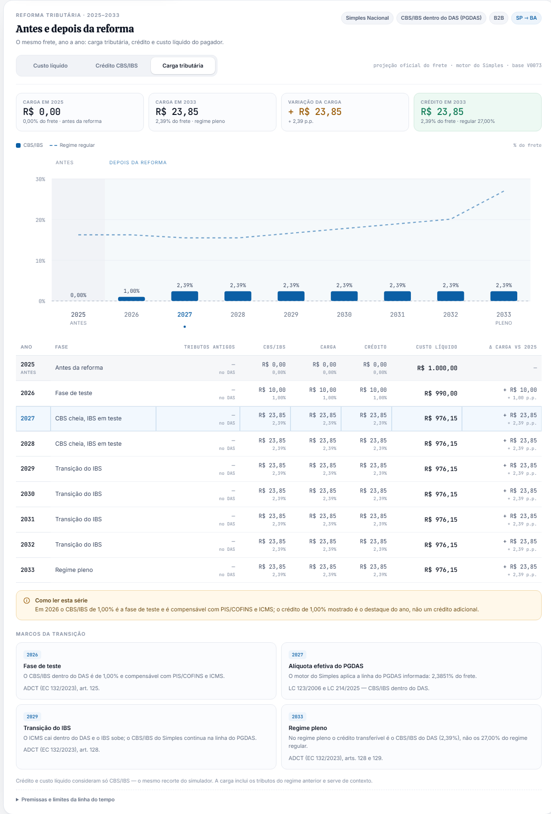
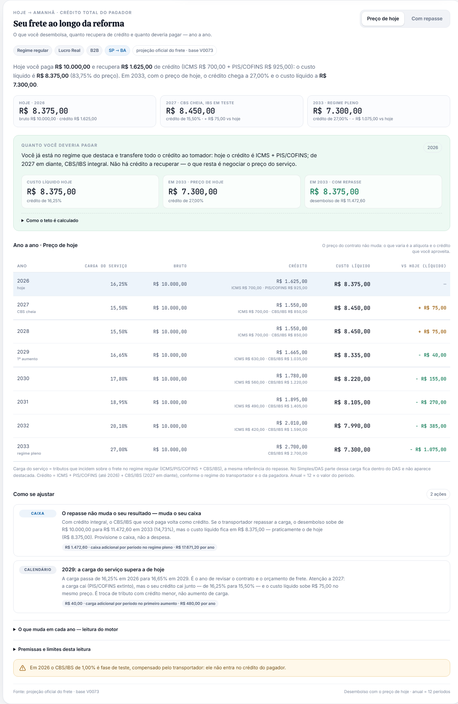
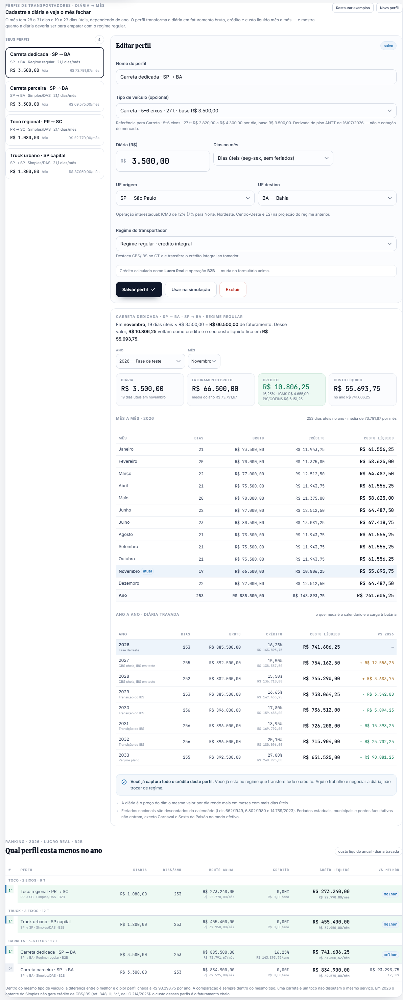
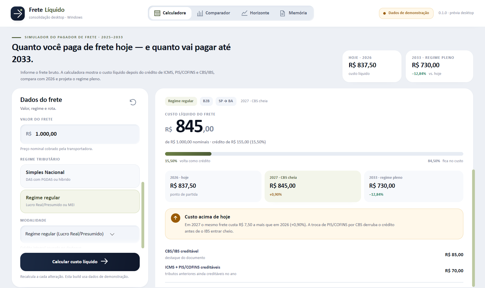
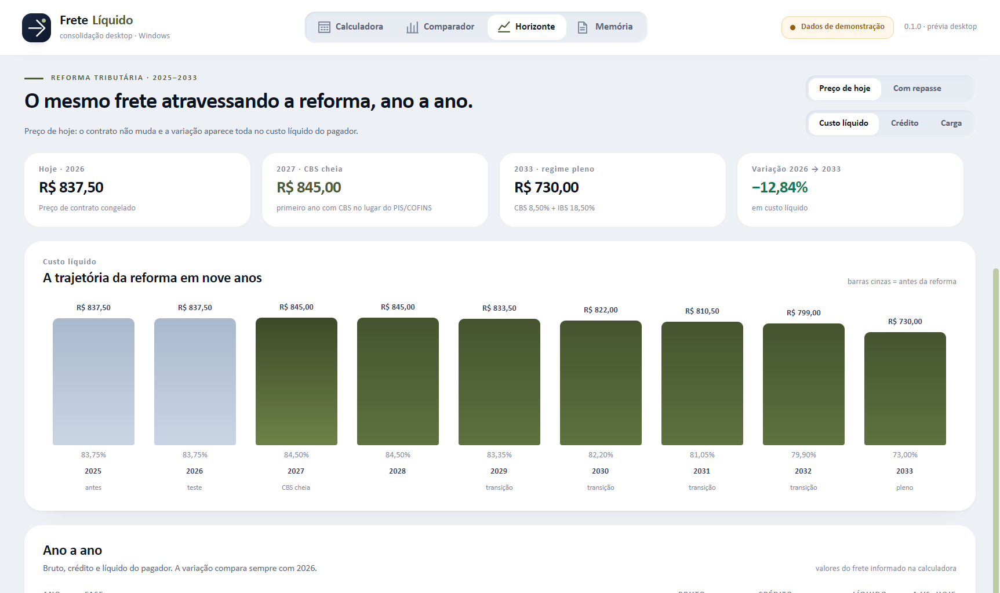

# Calculadora de Tributos

## Descrição do Projeto

API REST que realiza o cálculo da CBS, do IBS e do Imposto Seletivo (Reforma Tributária do Consumo — LC 214/2025) nas operações do regime geral, consulta as tabelas oficiais usadas no cálculo e gera e valida os grupos de tributação dos documentos fiscais eletrônicos.

---

## Público-Alvo

- Empresas de tecnologia
- Desenvolvedores
- Contribuintes em geral

---

## Funcionalidades

Todos os caminhos começam com `http://localhost:8080/api/calculadora`. A lista completa, com esquemas e exemplos, está no Swagger (`http://localhost:8080/api/swagger-ui.html`).

| Funcionalidade | Endpoint |
|---|---|
| Cálculo de tributos (a operação inteira falha no primeiro erro) | `POST /regime-geral` |
| Cálculo com observabilidade (erros por item, sem interromper os demais) | `POST /observabilidade/regime-geral` |
| Descrição de um código de erro da observabilidade | `GET /observabilidade/erros?codigo=REG-011` |
| Base de cálculo unificada da NF-e/NFC-e | `POST /base-calculo/base-calculo-unificada` |
| Base de cálculo unificada da NFS-e | `POST /base-calculo/base-calculo-unificada-nfse` |
| Geração do XML a partir do resultado do cálculo | `POST /xml/generate?tipo=nfe` |
| Validação de XML (grupo ou nota) contra o XSD | `POST /xml/validate?tipo=nfe&subtipo=grupo` |
| CST e classificações tributárias (cClassTrib) | `GET /dados-abertos/situacoes-tributarias/cbs-ibs`, `GET /dados-abertos/classificacoes-tributarias/...` |
| Fundamentações legais | `GET /dados-abertos/fundamentacoes-legais` |
| NCM e NBS | `GET /dados-abertos/ncm`, `GET /dados-abertos/nbs` |
| Alíquotas de referência (União, UF e município) | `GET /dados-abertos/aliquota-uniao`, `/aliquota-uf`, `/aliquota-municipio` |

Exemplos de utilização da API estão em [docs/exemplos.md](docs/exemplos.md).

### Dois motores oficiais

Este fork reúne as duas calculadoras oficiais da Receita para a reforma do consumo:

| Motor | Repositório | Porta | Papel |
|---|---|---|---|
| Regime regular | [`calculadora-rtc-regime-regular`](https://github.com/ReceitaFederal/calculadora-rtc-regime-regular) | `8080` | CBS/IBS das operações do regime regular |
| Simples Nacional | [`calculadora-rtc-simples-nacional`](https://github.com/ReceitaFederal/calculadora-rtc-simples-nacional) | `8082` | CBS/IBS do Simples (CT-e, NF-e, NFS-e) |

O código do Simples está em `simples-nacional/`, incorporado ao fork como *subtree* do repositório oficial. Os
dois motores são aplicações Spring Boot independentes, leem o **mesmo SQLite** (`calculadora/db/calculadora-pro.db`)
e compartilham o schema criado pelo Flyway (a base já contém as tabelas do Simples a partir da `V0071`).

```powershell
# compilar os dois motores (uma vez)
.\mvnw.cmd -DskipTests package
.\mvnw.cmd -f simples-nacional\pom.xml -DskipTests package

# subir motores + interface
.\run.ps1
```

O app escolhe o motor pelo perfil do transportador: regime regular e Simples híbrido usam a `8080`; Simples/DAS
com alíquotas do PGDAS usa a `8082`.

### Simulador de frete

Além dos endpoints de cálculo, este fork inclui um simulador da carga tributária do **transporte de
cargas** ao longo da transição da reforma (2025 a 2034), com interface visual simples em três abas:

1. **Projeção anual** — valor do frete **diário, quinzenal ou mensal**, contando apenas **dias úteis**
   (segunda a sexta), com comparativo ano a ano ("hoje pagamos isso, amanhã pagamos aquilo"), notas
   por etapa e a **tabela oficial de ICMS interestadual** (Resolução do Senado nº 22/1989).
2. **CT-e de hoje** — o pagamento de um CT-e real de novembro de 2026: composição do documento,
   tributos embutidos, retenções por tipo de transportador, créditos da pagadora e o que muda em
   2027, 2029 e 2033, incluindo o **split payment**.
3. **Produto & contrato** — 31 lacunas para transformar o simulador em produto de contas a pagar e as
   **12 cláusulas** do anexo tributário do contrato de transporte, com download em markdown.

- Interface: `http://localhost:8080/api/frete`
- API: `GET /api/calculadora/frete/parametros`, `POST /api/calculadora/frete/projecao`,
  `GET /api/calculadora/frete/cte/exemplo`, `POST /api/calculadora/frete/cte/pagamento`,
  `GET /api/calculadora/frete/produto`, `GET /api/calculadora/frete/produto/anexo`,
  `POST /api/calculadora/frete/credito`
- Documentação do modelo, premissas e cronograma: [docs/frete.md](docs/frete.md)
- Diagnóstico de produto e anexo contratual: [docs/produto.md](docs/produto.md)

O IBS e a CBS de cada ano são apurados pela própria calculadora do regime regular (item de CT-e,
cClassTrib `000001`); ICMS, PIS, COFINS e ISS são compostos conforme o cronograma de extinção.

O endpoint de crédito fecha a conta pelo lado de quem **paga** o frete: devolve o CBS/IBS destacado no
CT-e como crédito apropriável e o custo líquido (frete − crédito), com a memória de cálculo do motor.

### App web: Frete Líquido (custo líquido do pagador)

Interface web local, sem build step, para quem **paga** o frete acompanhar o custo líquido ao longo da
reforma. A interface principal foi redesenhada em **quatro páginas**:

- **Calculadora** — perfil do transportador (diária, competência, dias faturáveis, regime, operação e rota),
  crédito do mês, custo líquido, composição do crédito e gráfico bruto × líquido dos 12 meses;
- **Horizonte** — crédito efetivo por marco (2026, 2027, 2029 e 2033), líquido por R$ 100 mil e variação
  contra 2026;
- **Comparador** — os três regimes no mesmo trecho e ano, ranking por custo líquido, barra bruto/líquido e a
  leitura de por que a diária mais barata pode custar mais depois do crédito;
- **Memória** — recibo do mês, premissas, memória do motor e resposta bruta; exportação do cenário em JSON;
- **perfis salvos** — carregar, salvar, atualizar e excluir cenários; a diária vira faturamento mensal pelo
  calendário de dias úteis, com os mesmos motores oficiais.

O **Simples/DAS** usa as alíquotas efetivas do PGDAS quando informadas (motor do Simples, CT-e `tpDoc 57`,
`CRT 1`, atividade `05`); sem elas, vale a faixa setorial estimada. O **Simples híbrido** credita só o CBS/IBS
do regime regular — ICMS e PIS/COFINS ficam no DAS. O **regime regular** credita ICMS, PIS/COFINS e, a partir
de 2027, CBS/IBS. Em B2C o crédito é zero.

A interface anterior (página única, linha do tempo 2025–2033, horizonte do pagador e edição completa dos
perfis) está preservada em `/legado/index.html`.

Cada simulação chama o motor do regime escolhido: `POST /api/calculadora/regime-geral` (8080) ou
`POST /api/calculadora/observabilidade/simples-nacional/nao-assistido` (8082). A carga e os percentuais de
ICMS/PIS/COFINS vêm da projeção oficial do frete (`POST /api/calculadora/frete/projecao`, 8080) — o app não
recria o cronograma. Nenhuma alíquota de CBS/IBS é recalculada na aplicação: o destaque do motor é o teto do
crédito; apenas o Simples/DAS sem PGDAS e o autônomo/MEI usam faixa estimada.

```powershell
.\mvnw.cmd -DskipTests package
.\mvnw.cmd -f simples-nacional\pom.xml -DskipTests package
.\run.ps1
```

Interface local: `http://127.0.0.1:5180` · site do projeto:
<https://itsglutos.github.io/calc-regime-regular-fretes/>

Detalhes e API em [app/README.md](app/README.md) · arquitetura em [ARCHITECTURE.md](ARCHITECTURE.md).

As imagens abaixo são da interface anterior, preservada em `/legado/index.html`.









### App desktop: Frete Líquido (instalável, .NET + Avalonia)

A consolidação em software instalável começou pela interface: a calculadora do
custo líquido é a tela principal, e o comparador, o horizonte 2025–2033 e a memória
de cálculo ficam em abas secundárias. O projeto está em [desktop/](desktop/README.md).

**Baixar**: [Frete Líquido desktop 0.1.0](https://github.com/ItsGlutos/calc-regime-regular-fretes/releases)
— executável único para Windows x64, autocontido (não exige .NET instalado).

- **.NET 8 + Avalonia 11** (XAML/C#): roda no Windows hoje e no Linux na fase
  seguinte, com o mesmo código e sem Visual Studio;
- **Soft UI**: superfícies de baixo contraste, sombras difusas, controles
  rebaixados, tipografia em Calibri (Carlito no Linux) e a paleta já estabelecida,
  com o azul de crédito trocado por **verde militar**;
- **dados de demonstração** nesta fase: o cronograma da LC 214/2025 e as regras de
  crédito são reproduzidos localmente; a troca pelos motores oficiais é uma
  interface (`ISimuladorFrete`);
- **compila, roda e tem testes**: build sem avisos no SDK 8, 32 testes do Core
  (cronograma, formatação pt-BR e comparador) e `dotnet publish` gerando um
  executável único de ~43 MB, sem exigir .NET na máquina do cliente;
- build e empacotamento (publish autocontido, MSIX/Inno Setup e roadmap Linux) em
  [desktop/installer/README.md](desktop/installer/README.md).

```powershell
cd desktop
dotnet build FreteLiquido.sln
dotnet test tests/FreteLiquido.Core.Tests
dotnet run --project src/FreteLiquido.Desktop
```






---

## Requisitos

### Requisitos do Sistema

- **Java**: versão 25
- **Maven**: não precisa ser instalado; o Maven Wrapper (`mvnw` / `mvnw.cmd`) baixa a versão necessária na primeira execução (requer internet)
- **Git**: para clonar o repositório
- **Sistema Operacional**: Windows, macOS ou Linux

### Dependências Principais

O projeto utiliza as seguintes tecnologias:

- **Spring Boot 4.1.2**: Framework principal da aplicação web
- **SQLite**: Banco de dados embarcado
- **Flyway**: Migração e versionamento do banco de dados
- **Springdoc OpenAPI 3.2.0**: Documentação interativa da API (especificação OpenAPI 3.1)

---

## Instruções de Instalação

### 1. Pré-requisitos

Certifique-se de ter instalado o Java 25 ou superior e verifique as versões:

```bash
# Verificar versão do Java
java -version
```

### 2. Clonar o Repositório

```bash
git clone https://github.com/ReceitaFederal/calculadora-rtc-regime-regular.git
cd calculadora-rtc-regime-regular
```

### 3. Gerar o Banco de Dados (obrigatório)

O perfil `offline` lê o banco `./calculadora/db/calculadora-pro.db`, definido por `application.db.filename` em `application-offline.yml`. O caminho é relativo à raiz do projeto e o banco é aberto em modo somente leitura.

> **Atenção:** a aplicação só funciona se o banco estiver gerado. Sem ele, o perfil offline não inicia.

Execute a partir da raiz do projeto.

**Linux/macOS:**

```bash
mkdir -p ./calculadora/db
./mvnw flyway:migrate -Dflyway.configFiles=./flyway/flyway-pro.conf --batch-mode --errors
```

**Windows:**

```bat
mkdir calculadora\db
mvnw.cmd flyway:migrate -Dflyway.configFiles=flyway\flyway-pro.conf --batch-mode --errors
```

Confirme que o arquivo foi criado com `ls -lah ./calculadora/db/calculadora-pro.db` (Linux/macOS) ou `dir calculadora\db\calculadora-pro.db` (Windows).

### 4. Compilar e Executar os Testes

Os testes exigem o banco gerado no passo 3, pois a maioria são testes de integração com o perfil `testes`.

Executar todos os testes com relatório de cobertura (JaCoCo):

**Linux/macOS:**

```bash
./mvnw clean test jacoco:report
```

**Windows:**

```bat
mvnw.cmd clean test jacoco:report
```

O relatório de cobertura fica em `target/site/jacoco/index.html`.

### 5. Executar a Aplicação com perfil Offline (spring-boot:run)

**Linux/macOS:**

```bash
./mvnw spring-boot:run -Dspring-boot.run.profiles=offline
```

**Windows:**

```bat
mvnw.cmd spring-boot:run "-Dspring-boot.run.profiles=offline"
```

A aplicação estará disponível em `http://localhost:8080/api`.

### 6. Gerar o JAR e Executar com java -jar (perfil offline)

**Linux/macOS:**

```bash
./mvnw clean package
java -Dspring.profiles.active=offline -jar target/api-regime-geral.jar
```

**Windows:**

```bat
mvnw.cmd clean package
java "-Dspring.profiles.active=offline" -jar target\api-regime-geral.jar
```

Execute o JAR a partir da raiz do projeto, para que `./calculadora/db` seja encontrado.

---

## Referências

- [Code of conduct](https://www.contributor-covenant.org)
- [MIT license](https://choosealicense.com/licenses/mit/)
- [Keep a Changelog](https://keepachangelog.com/pt-BR/1.1.0/)
- [Semantic Versioning](https://semver.org/lang/pt-BR/)

## Licença

Este projeto é distribuído sob a licença especificada no arquivo [LICENSE](LICENSE).