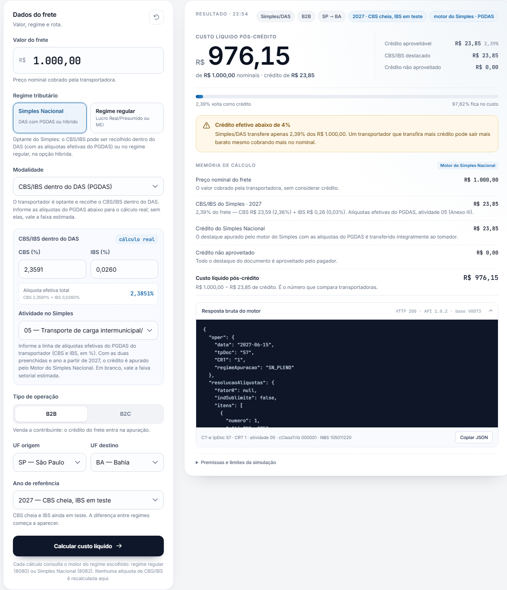
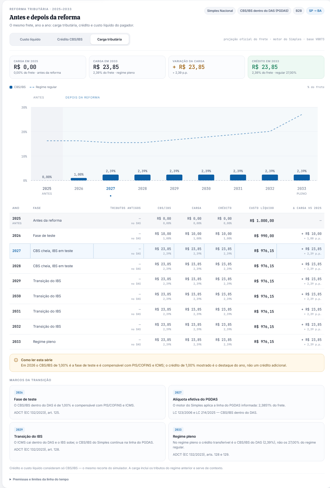

# Frete Líquido

Simulador local do **pagador do frete**: descobre o custo líquido real depois do crédito de CBS/IBS,
compara transportadoras de regimes tributários diferentes e mostra **o antes e o depois da reforma
tributária, ano a ano (2025–2033)**.

O CBS/IBS **não é calculado neste projeto**. Cada simulação chama um dos dois motores oficiais da Receita,
ambos com licença MIT e execução local, e a resposta bruta fica disponível na interface para auditoria:

| Perfil | Motor | Porta |
|---|---|---|
| Regime regular e Simples híbrido | [`calculadora-rtc-regime-regular`](https://github.com/ReceitaFederal/calculadora-rtc-regime-regular) | `8080` |
| Simples/DAS com alíquotas do PGDAS | [`calculadora-rtc-simples-nacional`](https://github.com/ReceitaFederal/calculadora-rtc-simples-nacional) | `8082` |





## Como rodar

Na raiz do repositório, compile os dois motores uma vez:

```powershell
.\mvnw.cmd -DskipTests package
.\mvnw.cmd -f simples-nacional\pom.xml -DskipTests package
```

Depois:

```powershell
.\run.ps1
```

O script sobe os dois motores (se ainda não estiverem no ar) e a aplicação em `http://127.0.0.1:5180`.
Se a política de execução bloquear:

```powershell
powershell -ExecutionPolicy Bypass -File .\run.ps1
```

Alternativa manual, com os motores já rodando:

```powershell
java -Dspring.profiles.active=offline -jar target\api-regime-geral.jar                    # terminal 1
java -Dspring.profiles.active=offline -jar simples-nacional\target\api-simples-nacional.jar # terminal 2
cd app; node server.js                                                                    # terminal 3
```

Requisitos: Node 20+ (testado no 24) e os dois JARs compilados. Os motores leem o mesmo SQLite em
`calculadora/db/calculadora-pro.db`.

## A modalidade Simples Nacional

O formulário começa pelo **regime tributário** — uma modalidade, não um detalhe do perfil:

- **Simples Nacional**: o optante recolhe o CBS/IBS **dentro do DAS** (com as alíquotas efetivas do
  PGDAS) ou escolhe o **híbrido** (CBS/IBS no regime regular, fora do DAS);
- **Regime regular**: Lucro Real/Presumido com crédito integral ou autônomo/MEI com faixa estimada.

O painel do Simples mostra as alíquotas efetivas de CBS e IBS, a **alíquota efetiva total** (soma das
duas) e a atividade no Simples (Anexo III). Com as duas preenchidas e ano a partir de 2027, o crédito é
o destaque apurado pelo motor do Simples (`CT-e tpDoc 57`, `CRT 1`, atividade `05`). Em branco, vale a
faixa setorial de 0,92% a 4% do frete, sinalizada como estimativa.

## Como o cálculo funciona

1. A aplicação monta um item de CT-e (NBS `105011220`, cClassTrib `000001`) com o valor do frete.
2. Pelo perfil, escolhe o motor:
   - **regime regular e Simples híbrido**: item com CST `000` e
     `POST /api/calculadora/regime-geral` na `8080`;
   - **Simples/DAS com PGDAS**: CT-e `tpDoc 57`, `CRT 1`, atividade `05` (Anexo III) e a linha de
     alíquotas efetivas do PGDAS em `POST /api/calculadora/observabilidade/simples-nacional/nao-assistido`
     na `8082`.
3. O motor devolve o CBS/IBS destacado (`vCBS` + `vIBS`) e a memória de cálculo oficial.
4. A aplicação aplica a regra de crédito do regime do transportador — o destaque é um **teto**:

| Perfil | Crédito | Natureza |
|---|---|---|
| Regime regular | 100% do destaque do motor | apurado |
| Simples híbrido | 100% do destaque (CBS/IBS no regime regular) | apurado |
| Simples/DAS com PGDAS | 100% do destaque apurado pelo motor do Simples | apurado |
| Simples/DAS sem PGDAS | 0,92% a 4,0% do frete (padrão 2,0%) | estimativa setorial |
| Autônomo / MEI | 1,8% a 4,0% do frete (padrão 1,8%) | estimativa setorial |

5. `custo líquido = valor do frete − crédito aproveitável`.
6. Em B2C o pagador é o consumidor final: o crédito não é aproveitável e o custo é o preço cheio.

O ano de referência padrão é **2033 (regime pleno, CBS 8,50% + IBS 18,50%)**. O motor do Simples só tem
tabelas a partir de **2027**; em 2026, o Simples/DAS cai na faixa estimada e o destaque de 1% limita o crédito.
O Simples híbrido e o regime regular funcionam em todos os anos do cronograma.

## Antes e depois da reforma (2025–2033)

Abaixo do resultado há uma linha do tempo com **o mesmo frete nominal em todos os anos** (valor diário,
para isolar o efeito das alíquotas). Ela tem três leituras, alternáveis:

| Leitura | O que mostra |
|---|---|
| **Custo líquido** | preço − crédito de CBS/IBS do regime escolhido, ano a ano |
| **Crédito CBS/IBS** | quanto volta como crédito (e o benchmark do regime regular) |
| **Carga tributária** | os tributos destacados no documento: antigos (ICMS/PIS/COFINS) + CBS/IBS |

A **carga** de cada ano vem da projeção oficial do frete do motor do regime regular
(`POST /api/calculadora/frete/projecao`), que apura o CBS/IBS pela mesma calculadora e compõe ICMS,
PIS/COFINS e ISS com o cronograma da LC 214/2025. O app não calcula CBS/IBS nem recria a tabela de
transição: quando o motor não expõe a projeção, a linha do tempo cai no CBS/IBS apurado ano a ano e
avisa que os tributos antigos não estão decompostos.

O recorte é explícito: **carga** inclui todos os tributos do documento; **crédito e custo líquido**
consideram só CBS/IBS, o mesmo recorte do simulador. Em B2C o crédito é zero.

Para o frete de R$ 1.000,00, SP → BA, a leitura é:

| Ano | Regime regular · carga | Regime regular · crédito CBS/IBS | Simples/DAS 2027 · crédito |
|---|---|---|---|
| 2025 (antes) | R$ 162,50 (16,25%) | R$ 0,00 | R$ 0,00 |
| 2026 (teste) | R$ 162,50 (16,25%) | R$ 10,00 (1,00%) | R$ 10,00 (1,00%) |
| 2027 | R$ 155,00 (15,50%) | R$ 85,00 (8,50%) | R$ 23,85 (2,39%) |
| 2029 | R$ 166,50 (16,65%) | R$ 103,50 (10,35%) | R$ 23,85 (2,39%) |
| 2033 | R$ 270,00 (27,00%) | R$ 270,00 (27,00%) | R$ 23,85 (2,39%) |

O ponto de virada da carga é **2029** (primeiro ano acima dos 16,25% de 2025) e o regime pleno chega a
27,00%. No Simples/DAS o crédito transferível é o CBS/IBS do DAS, não os 27% do regime regular — a linha
do tempo mostra a diferença contra o benchmark do regime regular.

## Aceite

Frete de R$ 1.000,00, SP → BA, em **2027**, com as alíquotas efetivas do PGDAS do exemplo (CBS 2,3591% +
IBS 0,0260%):

| Transportadora | Regime | Crédito | Custo líquido |
|---|---|---|---|
| Rota Sul Logística | Simples/DAS · PGDAS | R$ 23,85 (2,39%) | **R$ 976,15** |
| Via Brasil Transportes | Simples híbrido · regime regular | R$ 85,00 (8,50%) | **R$ 915,00** |

O comparador ordena por custo líquido: o híbrido vence com o mesmo preço nominal, e o Simples/DAS dispara o
alerta de crédito abaixo de 4%.

Na linha do tempo, o mesmo frete no **regime regular** em 2033 dá R$ 270,00 de CBS/IBS destacado e
crédito, com custo líquido de **R$ 730,00**; a carga no regime pleno é 27,00%, contra 0,00% de CBS/IBS
destacado no Simples em 2025 e 2,39% em 2027.

## API

- `GET /api/opcoes` — regimes, perfis, faixas, UFs, anos, série da reforma, atividades do Simples e status
  dos dois motores.
- `POST /api/simular` — `{ valorFrete, perfil, tipoOperacao, ufOrigem, ufDestino, ano, taxaCredito?,
  aliquotaCbs?, aliquotaIbs?, atividade? }`.
- `POST /api/reforma` — a mesma entrada de `/api/simular`, devolvendo `anos[]` (2025–2033) com
  `antigos`, `cbsIbs`, `carga`, `credito`, `custoLiquido`, `percentualCarga`, `percentualCredito`,
  `disponivel` e `fonte`; mais `resumo`, `benchmark`, `notas`, `premissas`, `avisos` e `fonte`.
- `POST /api/comparar` — `{ transportadoras: [{ nome, preco, perfil, aliquotaCbs?, aliquotaIbs?, atividade? }],
  ano, tipoOperacao, ufOrigem, ufDestino }`.
- `GET /api/saude` — status, versão e base dos motores regular e do Simples.

Cada resposta de `/api/simular` traz `motor.fonte` (`regime-regular` ou `simples-nacional`), `motor.nome`,
`motor.resposta` (JSON bruto do motor), `motor.requisicao` (payload enviado), a memória de cálculo em
`memoria[]`, as premissas e os `avisos` (por exemplo, quando o Simples/DAS caiu na estimativa).

`/api/reforma` preserva os mesmos princípios: a carga dos anos 2026–2033 sai da projeção oficial do motor
(cada ano com o CBS/IBS apurado pela calculadora), e o crédito/custo é a regra do regime aplicada ao
destaque. Se a projeção não existir no motor, a resposta não falha: devolve a série só de CBS/IBS, marca
2025 como indisponível e inclui o aviso — a interface mostra os traços e o motivo.

## Estrutura

```
app/
  server.js        HTTP + validação + memória de cálculo + comparador + linha do tempo
  domain.js        perfis, regimes, faixas, atividades do Simples, UFs e cronograma
  engine.js        clientes dos motores regular e do Simples + projeção anual, sem regra tributária
  public/
    index.html     página única
    styles.css     estilo, sem build
    app.js         comportamento (formulário, resultado, comparador e linha do tempo)
```

Variáveis de ambiente: `PORT` (padrão 5180), `MOTOR_URL` (padrão `http://127.0.0.1:8080`) e
`MOTOR_SIMPLES_URL` (padrão `http://127.0.0.1:8082`).

O Simples/DAS usa as alíquotas efetivas do PGDAS quando informadas; sem elas, e para autônomo/MEI, valem as
faixas setoriais estimadas, sinalizadas na interface. A linha do tempo usa PIS/COFINS não cumulativo
(1,65% + 7,60%) e a tabela de ICMS interestadual do motor; em operação interna, o ICMS padrão é 18% e o
aviso lembra que a alíquota interna varia por UF. A ferramenta é de simulação e não substitui a apuração
fiscal.
