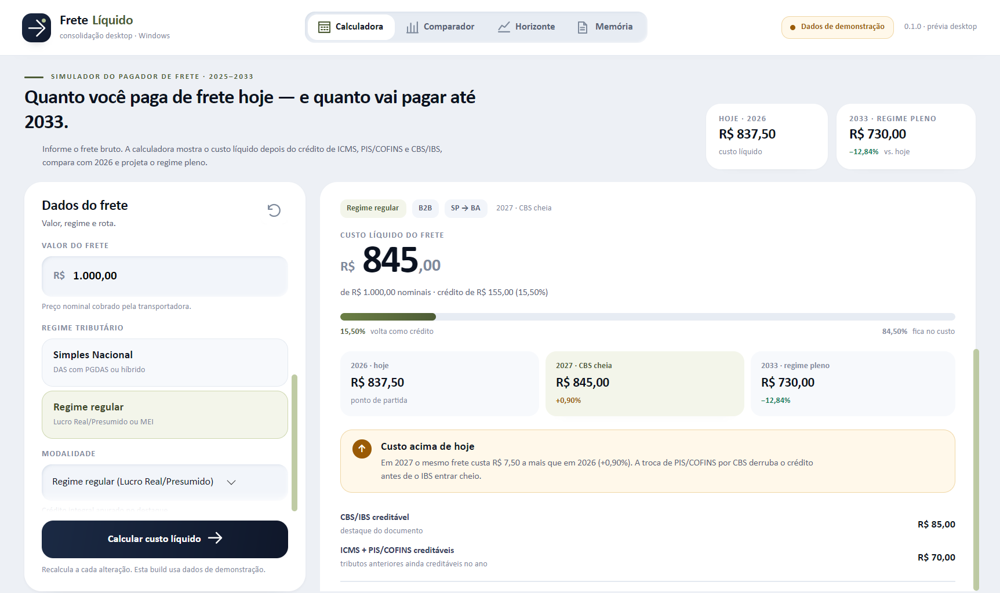

# Frete Líquido — desktop

Aplicativo desktop do Frete Líquido: a calculadora do custo líquido do frete e a
comparação dos valores **antes e depois da reforma tributária** em uma janela
nativa, com as telas secundárias (comparador, horizonte e memória de cálculo)
separadas da calculadora.

Este diretório é a **fase 1 da consolidação**: a interface completa, compilando e
rodando no Windows, com dados de demonstração. A integração com os motores
oficiais é a fase seguinte.



## Stack

| Item | Escolha | Por quê |
|---|---|---|
| Runtime | .NET 8 (LTS) | suportado no Windows e no Linux |
| UI | Avalonia 11.3 | XAML/C#, sem Visual Studio, com Windows e Linux no mesmo código |
| MVVM | próprio (`ObservableObject` + `RelayCommand`) | zero dependência além do Avalonia |
| Gráficos | templates com `ItemsControl` + `ProgressBar` | sem pacote de terceiros |
| Tipografia | Calibri → Carlito → Segoe UI | Calibri no Windows, Carlito (métrica idêntica) no Linux |

> **Sobre ".NET Flutter".** Flutter é Dart, não .NET, e o build para Windows exige
> Visual Studio com a carga de trabalho C++. Como o requisito era um app .NET
> instalável **com Linux no horizonte**, a escolha foi Avalonia: mesmo XAML/C# para
> os dois sistemas, build só com o SDK do .NET. A estrutura MVVM e as telas não
> dependem de nada específico do Avalonia além dos controles.

## O que está pronto

- **Calculadora** (tela principal, foco absoluto): valor do frete, regime,
  modalidade, B2B/B2C, regime de crédito da pagadora, rota e ano; o custo líquido
  aparece em destaque, com barra de crédito, o trio **2026 · hoje → ano escolhido →
  2033 · regime pleno** e o detalhe do crédito. Tudo recalcula a cada alteração.
- **Comparador**: três transportadoras (regular, híbrido e Simples/DAS), ranking
  por custo líquido e diferença em reais para o melhor.
- **Horizonte**: 2025–2033 em barras, dois cenários de preço (contrato congelado ou
  repasse integral) e três leituras (custo líquido, crédito, carga), com tabela
  ano a ano.
- **Memória**: linhas do cálculo, premissas, avisos e a resposta bruta em JSON
  (com botão de copiar).
- **Soft UI**: superfícies de baixo contraste, sombras difusas duplas, controles
  rebaixados por sombra interna e a paleta do produto com o azul de crédito
  trocado por **verde militar** (papel frio, tinta naval, oliva, âmbar de alerta).
- **Acessibilidade**: navegação por teclado com anel de foco visível nos botões e
  cartões, e nome acessível em todo controle sem texto próprio (as abas, os
  cartões de regime, os botões de ícone), para leitor de tela e automação.

Todas as telas compartilham a mesma simulação: mudar o formulário da calculadora
atualiza comparador, horizonte e memória.

## O que é demonstração

Nenhuma chamada é feita aos motores da Receita. `SimuladorDemonstracao` reproduz o
cronograma da LC 214/2025 e as regras de crédito documentadas no `app/README.md`:

- crédito de 16,25% em 2026 e 27,00% em 2033 no regime regular (R$ 1.000,00 →
  R$ 837,50 em 2026, R$ 845,00 em 2027 e R$ 730,00 em 2033);
- Simples/DAS com 2,39% a partir de 2027 (R$ 976,15);
- híbrido com 8,50% em 2027 (R$ 915,00), empatando em 2033.

O ponto de troca é uma interface: `ISimuladorFrete`. Basta implementar
`Simular`, `Serie` e `Comparar` chamando `POST /api/simular`, `/api/reforma` e
`/api/comparar` do app Node para o desktop passar a usar os motores oficiais.

## Requisitos

- **.NET SDK 8.0** ou superior ([download](https://dotnet.microsoft.com/download)).
  Só o SDK — não é necessário Visual Studio.
- Windows 10/11 para rodar; o mesmo projeto compila para Linux.

Se o SDK não estiver na máquina, dá para instalá-lo sem admin, no próprio perfil:

```powershell
$dir = "$env:LOCALAPPDATA\Microsoft\dotnet"
Invoke-WebRequest https://dot.net/v1/dotnet-install.ps1 -OutFile "$env:TEMP\dotnet-install.ps1"
& "$env:TEMP\dotnet-install.ps1" -Channel 8.0 -InstallDir $dir -NoPath
```

## Rodar

```powershell
cd desktop

# restaura e compila
dotnet build FreteLiquido.sln

# testes do Core (cronograma, formatação pt-BR, comparador)
dotnet test tests/FreteLiquido.Core.Tests

# executa
dotnet run --project src/FreteLiquido.Desktop
```

Ou com o script (verifica o SDK, compila e roda):

```powershell
.\scripts\build.ps1 -Run
```

### Verificação visual

`scripts/capturar-janela.ps1` abre o app, enquadra a janela na tela e salva um PNG
da área cliente — é como as imagens de `docs/preview/` são geradas e como a
interface é conferida a cada mudança:

```powershell
& .\scripts\capturar-janela.ps1                                   # calculadora
& .\scripts\capturar-janela.ps1 -Aba Comparador -Saida ..\app.png  # outra aba
```

O script trata dois detalhes de Windows que fazem a captura sair errada:
`SetForegroundWindow` é recusado quando quem chama não está em primeiro plano
(por isso a janela sobe para TOPMOST) e um `powershell.exe` sem consciência de DPI
enxerga a tela a 80% em monitor a 125%.

## Gerar o instalável

```powershell
.\scripts\publicar.ps1
```

Gera `artefatos/app/FreteLiquido.exe`: executável único, autocontido (não exige
.NET na máquina do cliente), ~43 MB comprimido. É o insumo do empacotamento —
para atalho no menu Iniciar, desinstalador e assinatura, siga
`installer/README.md` (MSIX ou Inno Setup).

Equivalentemente, na mão:

```powershell
dotnet publish src/FreteLiquido.Desktop -c Release -r win-x64 --self-contained true `
  -p:PublishSingleFile=true -p:IncludeNativeLibrariesForSelfExtract=true -o artefatos\app
```

Linux (fase 2):

```bash
dotnet publish src/FreteLiquido.Desktop -c Release -r linux-x64 --self-contained true \
  -p:PublishSingleFile=true -o artefatos/linux-x64
```

## Release

A Release do GitHub é gerada pelo workflow `release-desktop` a partir do tag
`desktop-vX.Y.Z`. O prefixo separa a linha de release do desktop da do app web
(que já está em 1.7.x), então um `v0.1.0` solto pareceria regressão:

```powershell
git tag -a desktop-v0.1.0 -m "Frete Líquido desktop 0.1.0"
git push origin desktop-v0.1.0
```

O workflow roda verificação de XAML, build, testes e `publicar.ps1` antes de
publicar; se `<Version>` de `Directory.Build.props` não bater com o tag, ele
falha antes de gerar o ativo. Saem `FreteLiquido-X.Y.Z-win-x64.exe` e
`SHA256SUMS.txt`, e as notas vêm de `docs/releases/X.Y.Z.md`. Republicar uma
release existente é rodar o workflow à mão com o tag: os ativos são
substituídos (`--clobber`), não duplicados — útil depois de corrigir as notas.

O ativo da release é construído no CI, a partir do commit do tag; o
`publicar.ps1` local serve para gerar e testar o executável antes de marcar.

## Estrutura

```
desktop/
  FreteLiquido.sln
  Directory.Build.props          versão única do Avalonia e do .NET
  scripts/
    build.ps1                    build + execução
    publicar.ps1                 executável único autocontido (win-x64)
    capturar-janela.ps1          abre o app e salva um PNG da tela real
    verificar-xaml.py            checagem estática de XML, recursos e bindings
    aplicar-nomes-acessiveis.py  nome acessível nos controles sem texto próprio
    gerar-icone.py               ícone do app (ICO + PNG)
  src/
    FreteLiquido.Core/           catálogo, regras de demonstração e formatação
      Modelos/                   opções, entrada, resultado, série anual
      Servicos/                  ISimuladorFrete, SimuladorDemonstracao, Formatador
    FreteLiquido.Desktop/        aplicativo Avalonia
      Temas/                     cores, tipografia e temas de controle (Soft UI)
      Infrastructure/            MVVM mínimo e paleta em código
      ViewModels/                calculadora, comparador, horizonte, memória
      Views/                     MainWindow + 4 telas
      Assets/                    ícone
  tests/
    FreteLiquido.Core.Tests/     32 testes: cronograma, pt-BR, comparador
  docs/
    design-soft-ui.md            sistema visual: tokens, escala, componentes
    preview/                     PNGs do app rodando + prévia HTML inicial
    releases/                    notas de cada versão publicada no GitHub
  installer/
    README.md                    empacotamento MSIX/Inno e roadmap Linux
```

## Próximos passos

1. Trocar `SimuladorDemonstracao` por um cliente HTTP dos motores (fase 2).
2. Empacotar MSIX assinado + auto-update e resolver o aviso de SmartScreen.
3. Histórico de simulações (SQLite) e exportação PDF/XLSX.
4. Portar para Linux (mesmo código; trocar Calibri por Carlito e testar o
   empacotamento AppImage/deb).

## Decisões e escopo

A escolha de stack e o que ficou de fora estão registrados em
[`docs/adr-001-stack-avalonia.md`](docs/adr-001-stack-avalonia.md). Em resumo: o estudo
[`docs/estudo-interface-desktop.md`](../docs/estudo-interface-desktop.md) recomendava Electron
reaproveitando a UI web; a decisão de produto foi uma GUI própria em .NET, com o custo de reescrita
assumido.

Ainda **não** fazem parte desta fase: histórico de simulações, exportação (PDF/XLSX/CSV), tema
escuro, i18n, auto-update e integração com os motores. O desenho de navegação por telas já prepara o
app para o workspace previsto no estudo.

