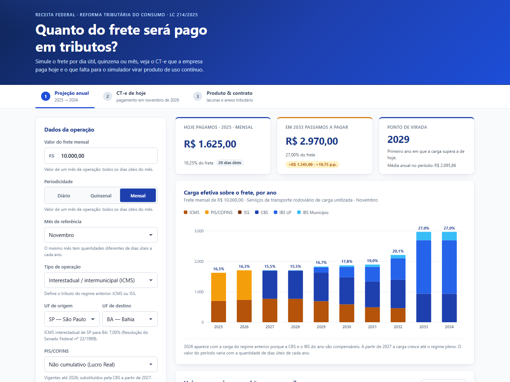
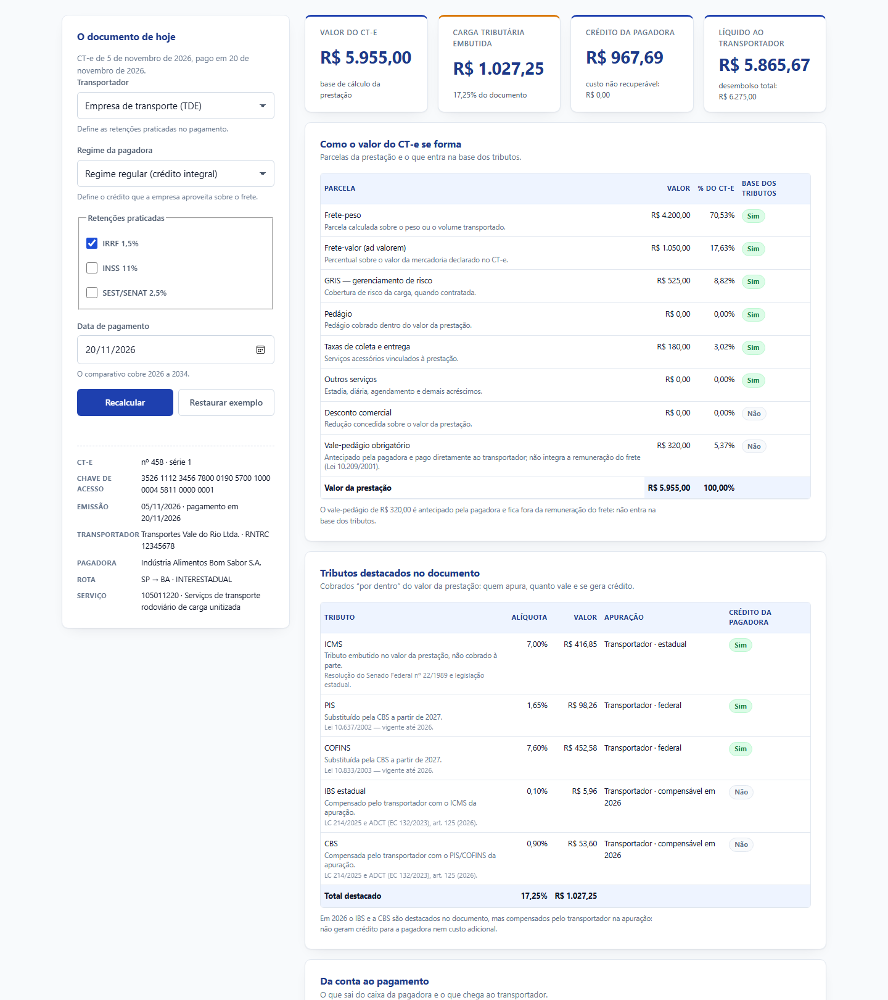
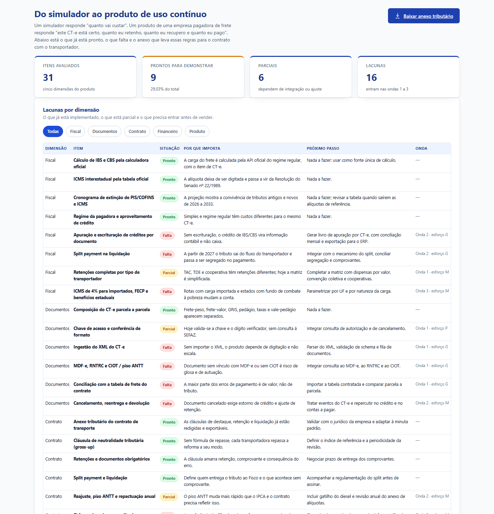
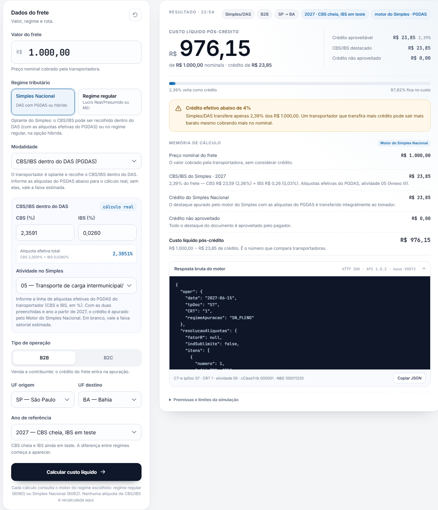
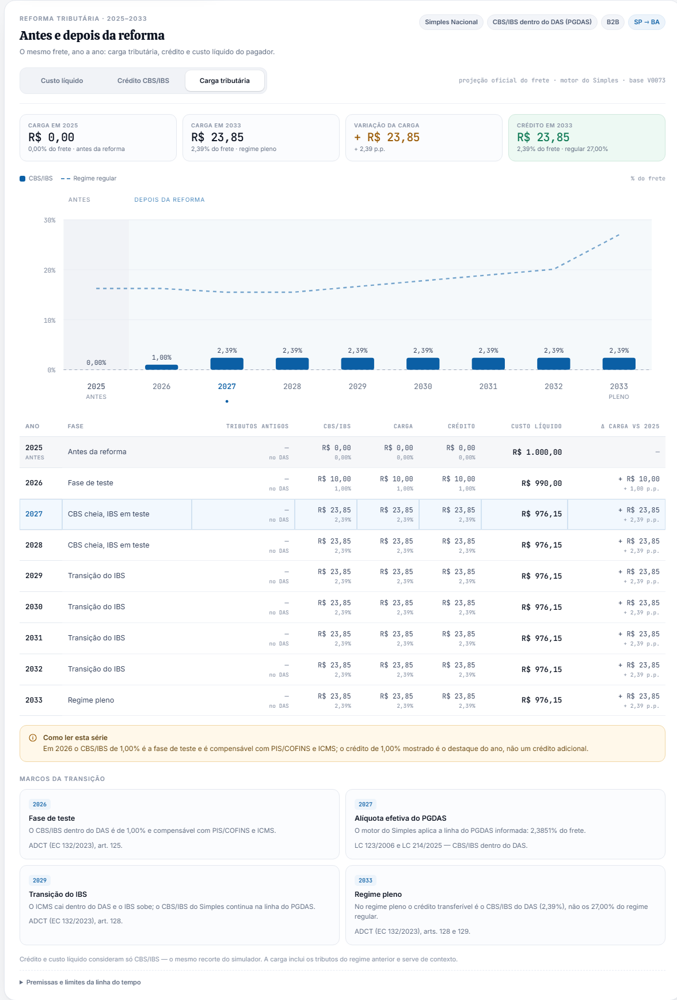

# Simulador de frete — carga tributária da reforma ao longo do tempo

Módulo construído sobre a calculadora do regime regular para responder a uma pergunta
específica: **quanto de tributo incide sobre uma operação de transporte de cargas em cada ano da
transição da reforma tributária do consumo (LC 214/2025)**.

A interface fica em `http://localhost:8080/api/frete` e usa a própria calculadora oficial
para apurar CBS e IBS — não há tabela de alíquotas paralela para o IBS/CBS.



---

## 1. Como executar

Pré-requisitos: **Java 25** e o banco SQLite gerado (passos do `README.md` principal).

```powershell
# 1) gerar o banco (só na primeira vez)
mkdir calculadora\db
.\mvnw.cmd flyway:migrate "-Dflyway.configFiles=flyway\flyway-pro.conf" --batch-mode

# 2) compilar e executar
.\mvnw.cmd clean package -DskipTests
java "-Dspring.profiles.active=offline" -jar target\api-regime-geral.jar
```

Atalhos:

| O quê | Endereço |
|---|---|
| Interface visual | `http://localhost:8080/api/frete` |
| Swagger (com o grupo Frete) | `http://localhost:8080/api/swagger-ui.html` |
| Parâmetros de referência | `GET http://localhost:8080/api/calculadora/frete/parametros` |
| Projeção | `POST http://localhost:8080/api/calculadora/frete/projecao` |

Scripts de apoio:

| Script | Para que serve |
|---|---|
| `scripts/servir.ps1 [-Screenshot]` | recompila, reinicia a aplicação e captura a tela |
| `scripts/teste-api-frete.mjs` | testes de contrato da API contra a aplicação em execução |
| `scripts/verificar-ui.mjs` | testa cliques, periodicidade, UF, memória de cálculo e erros de JS (CDP) |
| `scripts/capturar.mjs` | captura uma seção da página por seletor CSS |
| `scripts/verificar-app.mjs` | testa a interface Frete Líquido (carga, comparator, PGDAS 2027, troca de ano/perfil) via CDP |
| `scripts/capturar-app.mjs` | captura uma seção do Frete Líquido por seletor, com viewport configurável |

---

## 2. Premissa do valor do frete: dia útil, quinzena e mês

O valor informado pode ser **diário, quinzenal ou mensal**, e a projeção conta **apenas dias úteis
(segunda a sexta)**:

| Periodicidade | Dias úteis do período |
|---|---|
| Diário | 1 |
| Quinzenal | metade dos dias úteis do mês (arredondada para cima) |
| Mensal | todos os dias úteis do mês |

Regras aplicadas:

1. **Feriados não são considerados.** A premissa é a quantidade de dias úteis da semana, não a
   posição deles no calendário (vale tanto para seg–sex quanto para ter–sáb).
2. O valor informado é **do período** escolhido. A projeção calcula o **preço por dia útil**
   (valor ÷ dias úteis de 2025) e, para cada ano, reconstrói o valor do período com os dias úteis
   **daquele ano** — por isso o valor do período muda de um ano para o outro mesmo com o preço por
   dia útil constante.
3. O mês de referência (padrão: mês corrente) define quantos dias úteis entram na conta. Exemplo
   com novembro: 20 dias úteis em 2025, 21 em 2026, 22 em 2027.

Exemplo (mensal de R$ 10.000 em novembro, ICMS interestadual SP → BA):

| Ano | Dias úteis | Valor do período | Carga efetiva | % do frete |
|---|---|---|---|---|
| 2025 | 20 | R$ 10.000,00 | R$ 1.625,00 | 16,25% |
| 2026 | 21 | R$ 10.500,00 | R$ 1.706,25 | 16,25% |
| 2027 | 22 | R$ 11.000,00 | R$ 1.705,00 | 15,50% |
| 2033 | 22 | R$ 11.000,00 | R$ 2.970,00 | 27,00% |

---

## 3. O que o simulador calcula

Para cada ano de 2025 a 2034 a projeção compõe:

| Bloco | Origem | Como é calculado |
|---|---|---|
| CBS, IBS UF, IBS município | Calculadora oficial do regime regular | `POST /calculadora/regime-geral` interno, item de CT-e (modelo 57), CST `000`, cClassTrib `000001`, NBS do serviço escolhido |
| ICMS / ISS | Regime anterior | alíquota (da tabela interestadual ou informada) × valor do período, reduzida pelo cronograma de extinção |
| PIS / COFINS | Regime anterior | alíquota do regime escolhido (não cumulativo ou cumulativo), vigente até 2026 |

O transporte de cargas **não tem redução de alíquota** no IBS/CBS: a classificação aplicável é a
`000001` (tributação integral). Não há, portanto, `gRed` na resposta e a alíquota efetiva é igual
à nominal. Isso foi verificado na própria base: os serviços NBS `105…` (transporte de cargas) não
constam da tabela `NBS_APLICAVEL` nem da `PERCENTUAL_REDUCAO`.

### Cronograma usado

| Ano | CBS | IBS UF | IBS município | Redução de ICMS/ISS | Fase |
|---|---|---|---|---|---|
| 2025 | — | — | — | — | Referência (antes da reforma) |
| 2026 | 0,90% | 0,10% | 0,00% | 0% | Fase de teste |
| 2027 | 8,40% | 0,05% | 0,05% | 0% | CBS plena, IBS em teste |
| 2028 | 8,40% | 0,05% | 0,05% | 0% | CBS plena, IBS em teste |
| 2029 | 8,50% | 1,60% | 0,25% | 10% | Transição do IBS |
| 2030 | 8,50% | 3,20% | 0,50% | 20% | Transição do IBS |
| 2031 | 8,50% | 4,80% | 0,75% | 30% | Transição do IBS |
| 2032 | 8,50% | 6,40% | 1,00% | 40% | Transição do IBS |
| 2033 | 8,50% | 16,00% | 2,50% | 100% | Regime pleno |
| 2034 | 8,50% | 16,00% | 2,50% | 100% | Regime pleno (estável) |

**Procedência dos valores.** As alíquotas de 2026 são as únicas vigentes na base oficial
(`ALIQUOTA_REFERENCIA` — CBS 0,90%, IBS UF 0,10%, IBS município 0,00%). As alíquotas de 2027 em
diante estavam cadastradas na carga original (`B0001__sistema_tributario_completo.sql`) e foram
removidas pela migração `V0053__ajustes_aliquotas.sql`, porque a lei prevê que a alíquota de
referência seja fixada anualmente. Por isso a projeção usa essa tabela como *referência* e
permite sobrescrevê-la ano a ano, tanto na interface quanto na requisição.

A redução de ICMS e ISS acompanha a entrada do IBS: 10% em 2029, 20% em 2030, 30% em 2031,
40% em 2032 e extinção em 2033.

### Carga destacada × carga efetiva

- **Destacada**: soma de todos os tributos que aparecem no documento fiscal no ano.
- **Efetiva**: igual à destacada, exceto em 2026, quando CBS (0,90%) e IBS (0,10%) são
  compensáveis com PIS/COFINS e ICMS. A carga econômica de 2026 equivale, assim, à do regime
  anterior — o que aparece no gráfico e nos indicadores.

---

## 4. Tabela oficial de ICMS interestadual

A alíquota do ICMS é definida pela **Resolução do Senado Federal nº 22/1989** e depende da UF de
origem e de destino:

| Origem · Destino → | Norte | Nordeste | C.-Oeste | Sudeste* | ES | Sul |
|---|---|---|---|---|---|---|
| Norte | 12% | 12% | 12% | 12% | 12% | 12% |
| Nordeste | 12% | 12% | 12% | 12% | 12% | 12% |
| C.-Oeste | 12% | 12% | 12% | 12% | 12% | 12% |
| Sudeste* | 7% | 7% | 7% | 12% | 7% | 12% |
| ES | 12% | 12% | 12% | 12% | 12% | 12% |
| Sul | 7% | 7% | 7% | 12% | 7% | 12% |

\* Sudeste exceto Espírito Santo.

A interface traz a mesma matriz com a combinação selecionada destacada. O simulador aplica
automaticamente a alíquota quando o tipo de operação é **interestadual** e as UFs são informadas;
nos tipos **interna** e **municipal** a alíquota é editável (o ICMS interno varia por estado e o
ISS varia por município).

Não estão modelados:

- ICMS de **4%** para mercadorias importadas (Resolução do Senado nº 13/2012);
- adicional do **FECP**, que varia por estado.

---

## 5. Notas por etapa (o que muda em relação ao método anterior)

Para cada ano da transição a API devolve um bloco de notação com:

| Campo | Conteúdo |
|---|---|
| `resumo` | efeito do ano em reais e em pontos percentuais |
| `mudancas` | lista tributo a tributo: o que entra, o que sai, o que muda de alíquota e a variação de base por dias úteis |
| `comparacaoMetodoAnterior` | como o frete era tributado antes da reforma e o que muda no ano |
| `efeitoAbsoluto` / `efeitoPontosPercentuais` / `efeitoRelativo` | efeito comparado ao ano anterior |
| `fundamento` | base normativa da etapa |

Exemplo (2027, trecho real da resposta):

> De R$ 1.706,25 em 2026 para R$ 1.705,00 em 2027: redução de -R$ 1,25 (0,75 p.p.).
> - Valor do frete no período: R$ 10.500,00 em 2026 para R$ 11.000,00 em 2027 (22 dias úteis contra 21), mantendo o preço por dia útil em R$ 500,00.
> - CBS passa de 0,90% (R$ 94,50) para 8,40% (R$ 924,00).
> - Sai PIS de 1,65%: deixa de ser cobrado R$ 173,25.
> - Sai COFINS de 7,60%: deixa de ser cobrado R$ 798,00.
>
> **Comparação com o método anterior:** no método anterior (2025) o frete pagava ICMS de 7,00% +
> PIS/COFINS de 9,25%… Em 2027 o PIS/COFINS sai e a CBS entra integral (8,40%), mas o ICMS continua
> sendo cobrado: o frete paga CBS e ICMS ao mesmo tempo até 2028.

---

## 6. API

### `GET /api/calculadora/frete/parametros`

Devolve o horizonte, o catálogo de 24 serviços de transporte (por modal), periodicidades, regimes
de PIS/COFINS, as 27 UFs com região e capital, a **tabela de ICMS interestadual** (36 combinações),
o cronograma de alíquotas e as notas metodológicas.

### `POST /api/calculadora/frete/projecao`

```json
{
  "valorFrete": 10000.00,
  "periodicidade": "MENSAL",
  "mesReferencia": 11,
  "nbs": "105011220",
  "tipoOperacao": "INTERESTADUAL",
  "ufOrigem": "SP",
  "ufDestino": "BA",
  "regimePisCofins": "NAO_CUMULATIVO",
  "incluirMemoriaCalculo": true
}
```

| Campo | Obrigatório | Observação |
|---|---|---|
| `valorFrete` | sim | valor do período escolhido; maior que zero |
| `periodicidade` | não | `DIARIO`, `QUINZENAL` ou `MENSAL` (padrão) |
| `mesReferencia` | não | 1 a 12; padrão é o mês corrente |
| `nbs` | não | padrão `105011220`; precisa existir na base |
| `tipoOperacao` | não | `INTERESTADUAL` (padrão), `INTERNA`, `MUNICIPAL` |
| `ufOrigem` / `ufDestino` | não | obrigatórias na prática para `INTERESTADUAL`; a alíquota vem da tabela oficial |
| `aliquotaIcms` / `aliquotaIss` | não | usadas em `INTERNA` e `MUNICIPAL` (padrões 18% e 5%) |
| `regimePisCofins` | não | `NAO_CUMULATIVO` (padrão) ou `CUMULATIVO` |
| `municipio` / `uf` | não | local da operação enviado à calculadora oficial (padrão: capital da UF de destino) |
| `incluirMemoriaCalculo` | não | devolve a memória de cálculo de cada ano |
| `parametrosTransicao` | não | sobrescreve o cronograma nos anos de 2027 a 2034 |

Resposta (resumida):

```json
{
  "valorFrete": 10000.00,
  "periodicidade": "MENSAL",
  "mesReferencia": 11,
  "diasUteisReferencia": 20,
  "valorFreteDiario": 500.00,
  "aliquotaIcms": 7.00,
  "anos": [
    { "ano": 2025, "diasUteis": 20, "valorFretePeriodo": 10000.00, "valorIcms": 700.00,
      "valorPis": 165.00, "valorCofins": 760.00, "totalEfetivo": 1625.00, "percentualTotal": 16.25 },
    { "ano": 2027, "diasUteis": 22, "valorFretePeriodo": 11000.00, "valorCbs": 924.00,
      "valorIbsUf": 5.50, "valorIbsMun": 5.50, "valorIcms": 770.00,
      "totalEfetivo": 1705.00, "percentualTotal": 15.50,
      "variacaoAnoAnteriorAbsoluta": -1.25, "variacaoAnoAnteriorPontosPercentuais": -0.75 }
  ],
  "resumo": {
    "anoReferencia": 2025, "percentualReferencia": 16.25,
    "anoRegimePleno": 2033, "percentualRegimePleno": 27.00,
    "diferencaAbsoluta": 1345.00, "diferencaPontosPercentuais": 10.75,
    "variacaoRelativa": 82.77, "anoPrimeiroAumento": 2029
  },
  "notasEtapa": [ { "ano": 2027, "resumo": "…", "mudancas": ["…"], "comparacaoMetodoAnterior": "…" } ],
  "avisos": ["…"],
  "versaoBaseDados": "V0073"
}
```

Sobrescrita de cenário:

```json
{
  "valorFrete": 1000,
  "parametrosTransicao": [
    { "ano": 2033, "cbs": 10, "ibsUf": 18, "ibsMun": 3, "reducaoIcmsIss": 100 }
  ]
}
```

Anos fora de 2027–2034 são recusados (2026 está definido em lei), com HTTP 400 e mensagem
explicando o motivo.

---

## 7. A aba do CT-e de hoje (novembro de 2026)

A segunda aba troca a pergunta: em vez de "quanto o frete paga de tributo ao longo do tempo", ela
mostra **a conta de um CT-e que a empresa pagadora recebe hoje**. O documento de exemplo é emitido em
5/11/2026 e pago em 20/11/2026 — data de referência do simulador.



### O documento de exemplo

| Campo | Valor |
|---|---|
| CT-e | nº 458, série 1, chave de acesso calculada a partir dos dados |
| Emitente | Transportes Vale do Rio Ltda. — CNPJ 12.345.678/0001-90 — RNTRC 12345678 |
| Pagadora | Indústria Alimentos Bom Sabor S.A. |
| Rota | SP → BA (interestadual, ICMS 7%) |
| Serviço | NBS 105011220 — transporte rodoviário de carga unitizada |
| Mercadoria | R$ 350.000,00 |

| Parcela | Valor | Na base? |
|---|---|---|
| Frete-peso | 4.200,00 | sim |
| Frete-valor (ad valorem) | 1.050,00 | sim |
| GRIS | 525,00 | sim |
| Taxas de coleta e entrega | 180,00 | sim |
| Vale-pedágio (antecipado) | 320,00 | **não** |
| **Valor da prestação** | **5.955,00** | — |

### O que está embutido no valor

| Tributo | Alíquota | Valor | Crédito da pagadora |
|---|---|---|---|
| ICMS | 7,00% | 416,85 | sim |
| PIS | 1,65% | 98,26 | sim |
| COFINS | 7,60% | 452,58 | sim |
| IBS estadual | 0,10% | 5,96 | não (compensado pelo transportador) |
| CBS | 0,90% | 53,60 | não (compensada pelo transportador) |
| **Total** | **17,25%** | **1.027,25** | **967,69** |

Os tributos são cobrados **"por dentro"**: não são acrescidos ao valor do CT-e, já estão no preço.
Por isso o simulador separa três coisas que costumam ser confundidas:

1. **carga embutida** — R$ 1.027,25 (17,25%), que o transportador apura;
2. **crédito da pagadora** — R$ 967,69 (ICMS + PIS/COFINS), que reduz custo, não desembolso;
3. **custo não recuperável** — R$ 0,00 no regime regular em 2026, porque o destaque de IBS/CBS é
   compensado pelo transportador na apuração.

### Do valor ao pagamento

| Linha | Valor |
|---|---|
| Valor da prestação | 5.955,00 |
| (−) IRRF 1,5% | −89,33 |
| **(=) Líquido ao transportador** | **5.865,67** |
| (+) Vale-pedágio antecipado | 320,00 |
| **(=) Desembolso da pagadora** | **6.275,00** |

### Retenções por tipo de transportador

| Retenção | TDE (empresa) | TAC (autônomo) | Base |
|---|---|---|---|
| IRRF 1,5% | sim | sim | IN RFB nº 1.234/2012 |
| INSS 11% | não (recolhe sobre a folha) | sim | Lei 8.212/1991, art. 31 |
| SEST/SENAT 2,5% | não (recolhe como empresa) | sim | Lei 8.706/1993 |

Com TAC, o líquido do exemplo cai para R$ 5.061,74 (retenções de R$ 893,26).

### O mesmo CT-e nos próximos anos

O comparativo congela o valor do documento para isolar o efeito das alíquotas e do split payment:

| Ano | ICMS | PIS/COFINS | CBS | IBS | Total | % | Split payment |
|---|---|---|---|---|---|---|---|
| 2026 | 416,85 | 550,84 | 53,60 | 5,96 | 1.027,25 | 17,25% | — |
| 2027 | 416,85 | 0,00 | 500,22 | 5,96 | 923,03 | 15,50% | 506,18 |
| 2029 | 375,17 | 0,00 | 506,18 | 110,17 | 991,52 | 16,65% | 616,35 |
| 2033 | 0,00 | 0,00 | 506,18 | 1.101,68 | 1.607,86 | 27,00% | 1.607,86 |

Duas leituras importantes:

- **2027 é ano de queda** na carga embutida (17,25% → 15,50%), porque o PIS/COFINS de 9,25% sai e a
  CBS entra em 8,40%, enquanto o ICMS segue cheio;
- a partir de 2027 o **split payment** segrega o IBS/CBS no pagamento: o valor sai do líquido do
  transportador e é recolhido pela pagadora, o que muda o caixa das duas pontas mesmo quando a carga
  total não muda.

### Conferência do documento

Cada CT-e exibe dez conferências, separadas por origem:

| Origem | O que é | Situação no exemplo |
|---|---|---|
| Cálculo | chave de acesso e DV, base de cálculo, destaque de IBS/CBS, ICMS interestadual, vale-pedágio | 5 OK |
| Contrato | retenções conferidas com a cláusula do contrato | manual |
| Integração | MDF-e/autorização, RNTRC/CIOT, split payment, conciliação com a tabela de frete | 3 pendentes, 1 não aplicável |

Essa separação é intencional: mostra o que o simulador já resolve sozinho e o que depende de
integração — é o mesmo diagnóstico da aba 3, aplicado a um documento real.

### Endpoints

| Método | Rota | Descrição |
|---|---|---|
| GET | `/api/calculadora/frete/cte/parametros` | Tipos de transportador, regimes da pagadora e anos cobertos |
| GET | `/api/calculadora/frete/cte/exemplo` | Entrada e resultado do CT-e de exemplo |
| POST | `/api/calculadora/frete/cte/pagamento` | Calcula o pagamento de um CT-e |

Exemplo de requisição mínima aceita:

```json
{
  "fretePeso": 4200,
  "freteValor": 1050,
  "gris": 525,
  "taxas": 180,
  "valePedagio": 320,
  "ufOrigem": "SP",
  "ufDestino": "BA",
  "tipoTransportador": "TAC",
  "dataPagamento": "2027-06-15"
}
```

Datas fora de 2026–2034 e base de cálculo menor ou igual a zero são recusadas com HTTP 400.

---

## 8. Produto e contrato

A terceira aba responde "o que falta para isto virar produto". O diagnóstico é servido pela própria
API (`GET /api/calculadora/frete/produto`) e organiza 31 itens em cinco dimensões, com situação
(pronto, parcial, falta), impacto, próximo passo, onda e esforço.



O mesmo endpoint que alimenta a tela gera o **anexo tributário** do contrato de transporte em
markdown (`GET /api/calculadora/frete/produto/anexo`), com 12 cláusulas, o cronograma de alíquotas e
os campos a preencher. O documento completo da análise está em [produto.md](produto.md).

---

## 9. Premissas e limitações

1. A carga é calculada sobre o valor do frete, **sem créditos de entradas** (combustível, pedágio,
   manutenção, aquisição de bens) nem retenções. O simulador mede a carga destacada/efetiva da
   operação, não o resultado da apuração trimestral.
2. Dias úteis **sem feriados**; a quinzena é metade dos dias úteis do mês.
3. Não são modelados benefícios fiscais estaduais nem regimes específicos.
4. ICMS de 4% para mercadorias importadas e adicional de FECP não estão incluídos.
5. O Imposto Seletivo não incide sobre o transporte de cargas, então não é composto.
6. 2027–2028: o IBS de 0,10% aparece como destacado; a eventual compensação com o ICMS prevista
   na transição não está modelada e pode ser ajustada no cronograma (`reducaoIcmsIss`).
7. A projeção assume um único serviço por operação; operações com composição de cargas diferentes
   exigem simulações separadas.
8. Os valores são estimativas para planejamento e não substituem a apuração fiscal.

---

## 10. Estrutura do código

| Caminho | Papel |
|---|---|
| `api/controller/FreteController.java` | Endpoints de parâmetros, projeção, produto e anexo contratual |
| `api/controller/CteController.java` | Endpoints de parâmetros, exemplo e pagamento de CT-e |
| `api/controller/FreteUiController.java` | Atalho `/api/frete` para a interface |
| `api/model/frete/*` | Contratos de entrada/saída (projeção, CT-e, notas, produto, tabela de ICMS) |
| `domain/service/frete/FreteProjecaoService.java` | Orquestra o cálculo ano a ano, compõe os tributos do regime anterior e monta as notas |
| `domain/service/frete/CtePagamentoService.java` | Pagamento de um CT-e: composição, tributos, retenções, créditos e comparativo |
| `domain/service/frete/IbsCbsFreteService.java` | Cálculo de IBS/CBS pela calculadora oficial, compartilhado pela projeção e pelo CT-e |
| `domain/service/frete/ProdutoFreteService.java` | Lacunas do produto, ondas e anexo contratual |
| `domain/service/frete/TransicaoTributariaService.java` | Cronograma de alíquotas e sobrescritas |
| `domain/service/frete/DiasUteisService.java` | Dias úteis do mês, do período e do ano |
| `domain/service/frete/IcmsInterestadualService.java` | Tabela do ICMS interestadual, regiões e capitais das UFs |
| `domain/service/frete/FreteCatalogoService.java` | Catálogo de NBS de transporte e opções de tributação |
| `domain/model/enumeration/{FaseTransicao,PeriodicidadeFrete,RegimePisCofins,TipoOperacaoFrete,RegiaoIcms,TipoTransportador,RegimePagadora}.java` | Enumerações do domínio |
| `resources/static/frete/{index.html,styles.css,app.js,tabs.js,cte.js,produto.js}` | Interface visual (HTML/CSS/JS sem etapa de build) |

A interface é intencionalmente simples: HTML, CSS e JS sem dependências, servidos pelo próprio Spring
Boot, divididos em três abas que carregam seus dados sob demanda. O objetivo é validar o fluxo e o
modelo de cálculo antes de investir na interface definitiva.

---

## 11. Próximos passos sugeridos

- Interface definitiva (componentes, estados de carregamento, comparação entre cenários).
- Tema escuro e revisão de contraste nos dois temas.
- Cálculo de carga líquida com créditos de entradas e efeito de PIS/COFINS não cumulativo.
- Comparação de dois cenários lado a lado e sensibilidade a variações de alíquota.
- Simulação por unidade de carga (R$/tonelada, R$/km) e por contrato anual.
- Filtro de feriados por UF e município.
- Importação do XML do CT-e e conciliação com a tabela de frete do contrato.
- Integração com MDF-e, RNTRC, CIOT e com o split payment na liquidação.
- Exportação para PDF e assinatura do anexo contratual.

---

## 12. Frete Líquido: o motor do Simples Nacional

O fork também incorpora o repositório oficial
[`calculadora-rtc-simples-nacional`](https://github.com/ReceitaFederal/calculadora-rtc-simples-nacional)
em `simples-nacional/`, como subtree. Ele é o segundo motor do app **Frete Líquido**: enquanto o motor do
regime regular apura CBS/IBS de um CT-e no regime regular, o motor do Simples apura o destaque de um
transportador optante, com a linha de alíquotas efetivas do PGDAS.

| Peça | Porta | Papel |
|---|---|---|
| Motor do regime regular | 8080 | CT-e do regime regular e do Simples híbrido |
| Motor do Simples | 8082 | CT-e `tpDoc 57`, `CRT 1`, atividade `05` |
| App Frete Líquido | 5180 | escolhe o motor, aplica a regra de crédito e monta a memória |

Os dois motores leem o mesmo `calculadora/db/calculadora-pro.db`; o schema já contém as tabelas do
Simples a partir da migração `V0071`.

### Perfis e crédito

| Perfil | Motor | Crédito |
|---|---|---|
| Regime regular | 8080 | 100% do destaque |
| Simples híbrido (CBS/IBS no regime regular) | 8080 | 100% do destaque |
| Simples/DAS com PGDAS | 8082 | 100% do destaque do Simples |
| Simples/DAS sem PGDAS | 8080 (teto) | 0,92% a 4% do frete — estimativa |
| Autônomo/MEI | 8080 (teto) | 1,8% a 4% do frete — estimativa |

O Simples híbrido **não** é o DAS: o optante escolheu recolher CBS/IBS no regime regular, então o CT-e
destaca o tributo cheio e o crédito é integral. O DAS integral usa o motor do Simples e as alíquotas do
PGDAS; sem elas, o app usa a faixa setorial e sinaliza a estimativa.

### Contrato usado

`POST /api/calculadora/observabilidade/simples-nacional/nao-assistido`:

```json
{
  "id": "frete-sn-...",
  "versao": "1.0.0",
  "data": "2027-06-15",
  "tpDoc": "57",
  "CRT": "1",
  "aliquotasEfetivas": {
    "anexoIII": {
      "pCBSSN": "2.3591",
      "pIBSSN": "0.0260",
      "semRedistribuicaoISS": { "pCBSSN": "2.3591", "pIBSSN": "0.0260" }
    }
  },
  "itens": [{
    "numero": 1,
    "cAtivSN": "05",
    "cClassTrib": "000001",
    "nbs": "105011220",
    "baseCalculo": "1000.00",
    "valorImpostoSeletivo": "0.00"
  }]
}
```

O motor devolve `objetos[0].tribCalc.vCBSSN`/`vIBSSN`, `memoriaCalculo` e `total`; o app usa o destaque
como teto e, no perfil com PGDAS, credita 100% dele.

### Rodar

```powershell
.\mvnw.cmd -DskipTests package
.\mvnw.cmd -f simples-nacional\pom.xml -DskipTests package
.\run.ps1
```

Aceite: frete de R$ 1.000,00, SP → BA, 2027, CBS 2,3591% + IBS 0,0260% no PGDAS → crédito de R$ 23,85 e
custo líquido de R$ 976,15; o híbrido no regime regular (8,50% em 2027) fica em R$ 915,00.

### Modalidade Simples Nacional na interface

O formulário do Frete Líquido começa pelo **regime tributário**, e não pelo perfil: **Simples Nacional**
ou **regime regular**. Dentro do Simples há duas modalidades — o CBS/IBS **dentro do DAS** (com as
alíquotas efetivas do PGDAS) e o **híbrido** (CBS/IBS no regime regular) —, e no regime regular há o
Lucro Real/Presumido e o autônomo/MEI. O painel do Simples exibe CBS e IBS informados, a **alíquota efetiva
total** e a atividade (Anexo III); sem as alíquotas, a faixa setorial de 0,92% a 4% é sinalizada como
estimativa.



### Antes e depois da reforma, ano a ano

Abaixo do resultado, a seção **Antes e depois da reforma** mostra o mesmo frete nominal de 2025 a 2033
com três leituras alternáveis: **custo líquido**, **crédito de CBS/IBS** e **carga tributária**. Cada ano
traz a composição (tributos antigos + CBS/IBS), o crédito, o custo líquido e a variação contra 2025; o
gráfico marca o período "antes" (2025), a transição e o regime pleno (2033), e o regime regular aparece
como benchmark quando a leitura é de outro regime.

A **carga** vem da projeção oficial do frete do motor do regime regular
(`POST /api/calculadora/frete/projecao`), que apura o CBS/IBS pela mesma calculadora do regime geral e
compõe ICMS, PIS/COFINS (não cumulativo) e ISS com o cronograma da LC 214/2025. O app não calcula CBS/IBS
nem recria a tabela: se o motor em execução não expuser a projeção, a linha do tempo devolve a série só de
CBS/IBS, marca 2025 como indisponível e explica o motivo.

O recorte é explícito: a **carga** inclui todos os tributos do documento; **crédito e custo líquido**
consideram só CBS/IBS, o mesmo recorte do simulador. Em B2C o crédito é zero.

Para R$ 1.000,00, SP → BA:

| Ano | Carga no regime regular | Crédito CBS/IBS regular | Crédito Simples/DAS (PGDAS 2027) |
|---|---|---|---|
| 2025 (antes) | R$ 162,50 (16,25%) | R$ 0,00 | R$ 0,00 |
| 2026 (teste) | R$ 162,50 (16,25%) | R$ 10,00 (1,00%) | R$ 10,00 (1,00%) |
| 2027 | R$ 155,00 (15,50%) | R$ 85,00 (8,50%) | R$ 23,85 (2,39%) |
| 2029 | R$ 166,50 (16,65%) | R$ 103,50 (10,35%) | R$ 23,85 (2,39%) |
| 2033 | R$ 270,00 (27,00%) | R$ 270,00 (27,00%) | R$ 23,85 (2,39%) |

O primeiro ano com carga acima de 2025 é **2029**; o regime pleno chega a 27,00%. No Simples/DAS o crédito
transferível é o CBS/IBS do DAS (2,39% no exemplo), não os 27% do regime regular — a linha do tempo mostra
essa diferença contra o benchmark e um bloco de marcos com o fundamento de cada etapa.



O endpoint `POST /api/reforma` recebe a mesma entrada de `/api/simular` e devolve `anos[]` (2025–2033) com
`antigos`, `cbsIbs`, `carga`, `credito`, `custoLiquido` e percentuais, mais `resumo`, `benchmark`, `notas`,
`premissas`, `avisos` e a procedência (`fonte`). A interface alterna as leituras sem nova chamada; a
verificação de runtime (`scripts/verificar-app.mjs`) cobre a linha do tempo, a troca de métrica e a troca
de regime.
