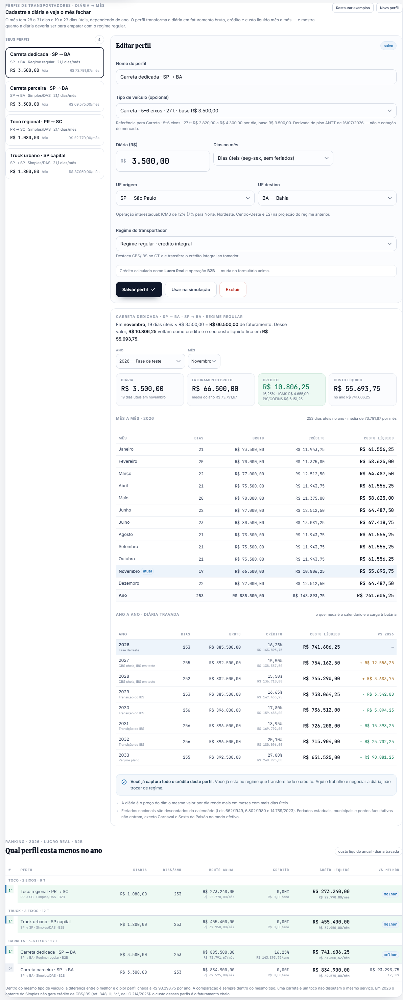

# Perfis de transportadores

A seção **Perfis de transportadores** transforma uma **diária** (R$ por dia de veículo) no
faturamento do mês e no custo líquido do pagador. Ela existe porque um mês não tem sempre os mesmos
dias: são 28 a 31 dias corridos e **19 a 23 dias úteis**, dependendo do ano e dos feriados.



## 1. O que o perfil guarda

| Campo | Obrigatório | Descrição |
|---|---|---|
| `nome` | sim | Nome livre do perfil (2 a 60 caracteres), único na base. |
| `diaria` | sim | Preço de **um dia de veículo à disposição**, em R$. Não é a diária de viagem do motorista (ajuda de custo) nem a estadia. |
| `tipoVeiculo` | não | `3/4`, `TOCO`, `TRUCK`, `CARRETA` ou `BITREM`. Serve para a faixa de referência e para agrupar o ranking. |
| `ufOrigem` / `ufDestino` | sim | A rota. Mesma UF = operação interna; UFs diferentes = interestadual. |
| `perfil` | sim | `REGIME_REGULAR`, `SIMPLES_DAS`, `SIMPLES_HIBRIDO` ou `AUTONOMO_MEI`. |
| `modoDias` | sim | Como os dias do mês são contados (ver §2). |
| `diasFixo` | quando `FIXO` | Dias por mês, de 1 a 31. |
| `aliquotaCbs` / `aliquotaIbs` | não | Alíquotas efetivas do PGDAS, quando o transportador é Simples/DAS. Sem elas, vale a faixa setorial de 0,92% a 4%. |
| `dasTotal` | não | DAS total em % da receita. Só é usado para mostrar a **receita líquida do transportador**; não entra no crédito. |
| `tipoOperacao` | sim | `B2B` (crédito aproveitável) ou `B2C` (sem crédito). |
| `observacao` | não | Texto livre de até 240 caracteres. |

Limites: **30 perfis** por instalação, diária entre R$ 1,00 e R$ 100.000,00.

## 2. Calendário: por que o mês não fecha sempre igual

| Modo | Contagem | Uso |
|---|---|---|
| `UTEIS` (padrão) | Seg–sex, menos feriados nacionais | operação administrativa e rodoviária típica |
| `UTEIS_EFETIVOS` | Igual, menos Carnaval e Sexta-feira da Paixão | operação que para nesses dias |
| `UTEIS_SABADO` | Seg–sáb, menos feriados nacionais | autônomo ou contrato antigo em 6×1 |
| `CORRIDOS` | Todos os dias do mês | diária de veículo parado / contrato dedicado |
| `FIXO` | Número informado pelo usuário | mês com parada programada, contrato parcial |

Feriados nacionais descontados (Leis 662/1949, 6.802/1980 e 14.759/2023): 1/1, 21/4, 1/5, 7/9,
12/10, 2/11, 15/11, 20/11 e 25/12. Carnaval e Paixão são móveis (calculados a partir da Páscoa) e só
entram no modo efetivo; feriados estaduais, municipais e pontos facultativos não entram.

A contagem de 2026 dá **253 dias úteis** (21,08/mês), com mínimo de 19 em fevereiro e novembro e
máximo de 23 em julho. Em 2027, 255 dias úteis. É por isso que o faturamento mensal varia mesmo com a
diária travada.

> **EC 141/2026** (publicada em 16/10/2026): a partir de 16/12/2026 o teto semanal cai para 42 h e
> passam a valer **dois dias de repouso semanal**; em 16/12/2027 o teto é de 40 h. Na prática, a
> semana útil do motorista empregado passa a ter 5 dias — a escala 6×1 deixa de ser defensável como
> padrão. O produto mantém o modo `UTEIS_SABADO` para autônomo/MEI e contratos antigos, com aviso.

## 3. A conta

```
bruto do mês        = diária × dias faturáveis do mês
crédito do mês      = bruto do mês × (% de crédito do ano ÷ 100)
custo líquido       = bruto do mês − crédito do mês
```

O crédito usa **a mesma regra da simulação** (`creditosDoPagador` em `app/domain.js`):

- regime regular: ICMS + PIS/COFINS (até 2026) + CBS/IBS (2027 em diante), limitado ao destaque;
- Simples híbrido: só o CBS/IBS destacado no regime regular;
- Simples/DAS e autônomo/MEI: a alíquota efetiva do PGDAS (ou a faixa setorial estimada);
- **2026**: o CBS/IBS de 1,00% não gera crédito ao adquirente (LC 214/2025, art. 348, I; no Simples,
  art. 348, III, "c") — o perfil do Simples aparece com 0% de crédito no ano;
- B2C: crédito zero em todos os anos.

Cada mês é arredondado no centavo e o total do ano é a **soma dos meses** — não uma alíquota aplicada
ao bruto anual. Assim a tabela mensal e a anual fecham no mesmo centavo.

### 3.1 A diária-teto

Para um perfil fora do regime regular, o app calcula a diária que **empata** o custo líquido com um
transportador do regime regular no mesmo serviço:

```
diária-teto = (custo líquido anual do regime regular ÷ dias do ano) ÷ (1 − crédito % do perfil)
```

O resultado aparece com a diferença anual e mensal. No Simples, é o número que faltava para negociar:
o preço nominal menor pode custar mais caro depois do crédito.

### 3.2 O ranking é por tipo de veículo

Comparar uma carreta com um toco não decide nada. O comparador agrupa por `tipoVeiculo` e ordena
**dentro do grupo** pelo custo líquido anual. Perfis sem tipo informado ficam em um grupo próprio.
Empate só é possível com o mesmo tipo, a mesma rota e o mesmo tipo de operação.

## 4. Série 2026–2033

Com a diária travada, o que muda de um ano para o outro é o calendário e a carga tributária. O perfil
mostra bruto, % de crédito, crédito e custo líquido para os oito anos, com a variação contra o ano de
referência. A diária não é corrigida por inflação — é um cenário de preço constante, não uma projeção
de reajuste.

## 5. API

| Método | Rota | O que faz |
|---|---|---|
| `GET` | `/api/perfis` | lista os perfis salvos (cartões, sem cálculo fiscal) |
| `POST` | `/api/perfis` | cria um perfil (`201`); valida nome único e limites |
| `GET` | `/api/perfis/:id?ano=2026&mes=11&regimePagadora=NAO_CUMULATIVO&tipoOperacao=B2B` | visão completa do perfil |
| `PUT` | `/api/perfis/:id` | atualiza campos enviados (parcial) |
| `DELETE` | `/api/perfis/:id` | remove o perfil |
| `POST` | `/api/perfis/calcular` | mesma visão, sem salvar (prévia do formulário) |
| `POST` | `/api/perfis/comparar` | ranking agrupado por tipo de veículo |
| `POST` | `/api/perfis/exemplos` | restaura os quatro perfis de exemplo |

Exemplo de criação:

```bash
curl -s http://127.0.0.1:5180/api/perfis -H "Content-Type: application/json" -d '{
  "nome": "Carreta dedicada · SP → BA",
  "diaria": 3500,
  "tipoVeiculo": "CARRETA",
  "ufOrigem": "SP",
  "ufDestino": "BA",
  "perfil": "REGIME_REGULAR",
  "modoDias": "UTEIS",
  "tipoOperacao": "B2B"
}'
```

A resposta de `calcular`/`GET :id` traz `meses` (12 linhas), `totais`, `anos` (2026–2033), `deveria`
(diária-teto e economia), `alertas`, `notas` e `fonte`.

## 6. Validações e avisos

- nome vazio/curto, diária ≤ 0, UF ou regime inválidos → `400` com `campo` para a interface focar;
- diária **abaixo de 40%** da base do tipo de veículo → alerta alto (provável confusão com diária de
  viagem ou valor mensal);
- diária fora da faixa `mín–máx` → alerta médio, sem bloquear;
- mais de 26 dias fixos em perfil que não é autônomo/MEI → alerta médio (EC 141/2026);
- autônomo/MEI com faturamento anual acima de **R$ 251.600,00** → alerta alto (LC 123/2006, art. 18-F);
- perfis de exemplo: carreta no regular e carreta no Simples no mesmo trecho, para mostrar que o
  desconto nominal pode custar mais caro no líquido.

## 7. Persistência

`app/data/perfis.json`, escrita atômica (arquivo temporário + `rename`) e fila de gravação. Um JSON
inválido é preservado como `perfis.invalido-<timestamp>.json` e a base recomeça com os exemplos. O
arquivo não guarda dados fiscais: só o perfil e as datas de criação/atualização.

## 8. Faixas de diária

As faixas por tipo de veículo são **derivadas** do piso mínimo da ANTT (carga geral, 6 eixos, tabela
de 16/07/2026: R$ 8,80/km × 400 km/dia) e da escala de capacidade `(t/27)^0,55`. Não são cotações de
mercado e a tela diz isso. O estudo completo, com as contas abertas e as incertezas, está em
[`docs/especialista-custos-transportes/`](especialista-custos-transportes/):

| Tipo | Mín. | Base | Máx. | km/dia |
|---|---:|---:|---:|---:|
| 3/4 | 550 | 720 | 900 | 250 |
| Toco | 860 | 1.080 | 1.350 | 280 |
| Truck | 1.440 | 1.800 | 2.200 | 320 |
| Carreta | 2.820 | 3.500 | 4.300 | 400 |
| Bitrem | 3.820 | 4.800 | 5.850 | 450 |

## 9. O que o perfil não faz

- não calcula o piso mínimo da ANTT nem atesta conformidade com ele;
- não corrige a diária por inflação, câmbio ou reajuste de contrato;
- não substitui a apuração fiscal: o CBS/IBS continua vindo dos motores oficiais e a regra de crédito
  é a mesma da simulação;
- não modela ICMS-ST, retenções de IRRF/INSS/SEST-SENAT nem tributos locais;
- não assume feriados estaduais/municipais — para isso, use `FIXO` com o número real de dias.

## 10. Verificação

`node scripts/verificar-perfis.mjs` abre a interface em navegador headless e confere, contra um
calendário calculado fora do app: dias de novembro/2026, bruto, crédito e líquido do mês; troca de
mês; criação, edição e exclusão de perfil; preenchimento da diária pelo tipo de veículo; aviso de
faixa; ranking; e o botão "Usar na simulação". Gera `app/docs/web-perfis.png` e
`app/docs/web-perfis-mobile.png`.
