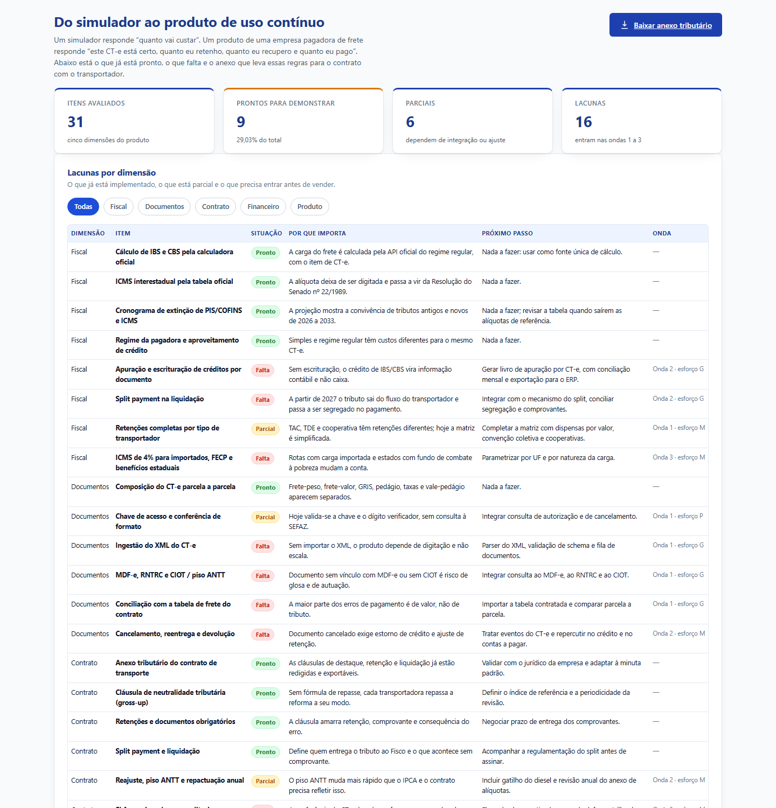

# Do simulador ao produto: lacunas, contrato e roteiro

Este documento responde a duas perguntas práticas para transformar o simulador de frete em produto
usado por uma empresa pagadora de frete:

1. **o que falta** para sair da simulação e entrar na rotina de contas a pagar;
2. **como levar a reforma para o contrato** com os transportadores, em cláusulas que resistam a
   auditoria, glosa e troca de alíquota.

O diagnóstico está implementado e é servido pela própria API (`GET /api/calculadora/frete/produto`),
exibido na aba **Produto & contrato** e exportável como anexo contratual
(`GET /api/calculadora/frete/produto/anexo`). Este texto é a leitura de negócio desse diagnóstico.

---

## 1. Resposta curta

O simulador já responde **"quanto do frete é tributo"** com aderência à calculadora oficial. Para ser
produto de uma pagadora, faltam três camadas:

| Camada | Pergunta que responde | Situação |
|---|---|---|
| Simulação | Quanto custa o frete em cada ano da reforma? | **pronto** |
| Documento | Este CT-e está correto e quanto eu retenho? | **parcial** — cálculo pronto, falta ler o XML e conciliar |
| Dinheiro | Quanto eu pago, quanto eu recupero e quando? | **falta** — split payment, contas a pagar e escrituração |

A distância não está no cálculo tributário: está em **ler o documento, conferir contra o contrato e
liquidar o pagamento**. É onde a pagadora perde dinheiro hoje (glosa mal feita, crédito não
aproveitado, retenção errada) e onde a reforma aumenta o risco a partir de 2027.

---

## 2. Onde o produto ganha dinheiro

Quatro alavancas, em ordem de retorno esperado:

1. **Glosa e retrabalho** — conferir CT-e contra a tabela de frete antes de pagar evita pagamento a
   maior e contestação depois.
2. **Crédito tributário** — ICMS e PIS/COFINS hoje, IBS/CBS a partir de 2027: documento errado é
   crédito perdido, e a reforma amplia o valor em jogo de ~9% para ~27% do frete.
3. **Retenção correta** — IRRF, INSS e SEST/SENAT dependem do tipo de transportador; reter a mais
   gera passivo com o transportador, reter a menos gera passivo com o Fisco.
4. **Caixa do split payment** — a partir de 2027 o tributo sai do fluxo do transportador e passa a ser
   segregado no pagamento; quem não se preparar perde prazo e comprovante.

Nenhuma delas é "calcular alíquota". A alíquota é a parte fácil e já está resolvida.

---

## 3. Diagnóstico por dimensão

O diagnóstico completo tem **31 itens** (9 prontos, 6 parciais, 16 ausentes). Abaixo, o que falta e o
que está pela metade, com o próximo passo.

### 3.1 Fiscal

| Item | Situação | Próximo passo |
|---|---|---|
| Retenções completas por tipo de transportador | parcial | completar a matriz com dispensas por valor, convenção coletiva e cooperativas |
| Apuração e escrituração de créditos por documento | falta | livro de apuração por CT-e, conciliação mensal e exportação para o ERP |
| Split payment na liquidação | falta | integração com o mecanismo, conciliação da segregação e comprovantes |
| ICMS de 4% para importados, FECP e benefícios estaduais | falta | parametrizar por UF e por natureza da carga |

Já prontos: cálculo de IBS/CBS pela calculadora oficial, ICMS interestadual pela tabela do Senado,
cronograma de extinção de PIS/COFINS e ICMS, e regime da pagadora (regular × Simples) no custo.

### 3.2 Documentos

| Item | Situação | Próximo passo |
|---|---|---|
| Chave de acesso e conferência de formato | parcial | integrar consulta de autorização e cancelamento na SEFAZ |
| Ingestão do XML do CT-e | falta | parser, validação de schema e fila de documentos |
| MDF-e, RNTRC e CIOT / piso ANTT | falta | consultas ao MDF-e, ao RNTRC e ao CIOT |
| Conciliação com a tabela de frete do contrato | falta | importar a tabela e comparar parcela a parcela |
| Cancelamento, reentrega e devolução | falta | tratar eventos do CT-e e repercutir em crédito e contas a pagar |

Já prontos: composição do CT-e parcela a parcela, com vale-pedágio fora da base.

### 3.3 Contrato

| Item | Situação | Próximo passo |
|---|---|---|
| Reajuste, piso ANTT e repactuação anual | parcial | incluir gatilho do diesel e revisão anual do anexo de alíquotas |
| SLA, avarias, glosas e auditoria | falta | fluxo de glosa motivada, prazo de defesa e trilha de auditoria |

Já prontos (minutas neste repositório): anexo tributário, neutralidade (gross-up), retenções e
documentos obrigatórios, split payment e liquidação.

### 3.4 Financeiro

| Item | Situação | Próximo passo |
|---|---|---|
| Conta a pagar com segregação tributária | parcial | títulos com rateio de tributo, retenção e vale-pedágio, exportados ao ERP |
| Fluxo de caixa do split payment | falta | projeção por documento, com data de segregação e de repasse |
| Rateio por centro de custo, rota e unidade | falta | parametrizar rateio e relatório por dimensão |
| Orçamento anual com índice de reajuste | falta | cenário base, conservador e de estresse por ano |
| Relatórios gerenciais e trilha de auditoria | parcial | padronizar relatórios e versionar cada cálculo |

### 3.5 Produto

| Item | Situação | Próximo passo |
|---|---|---|
| API pública, webhooks e integração com ERP | parcial | contrato OpenAPI, autenticação e eventos de status |
| Multiempresa, perfis e permissões | falta | tenancy, papéis e segregação por CNPJ |
| LGPD, retenção e descarte de dados | falta | política de retenção, registro de operações e resposta a incidentes |
| Observabilidade, SLA e continuidade | falta | métricas, alertas, backup e continuidade |
| Onboarding e importação de contratos | falta | assistente de implantação e importação em massa |
| Empacotamento comercial, preço e ROI | falta | planos por volume de CT-e e ROI calculado com o cliente |

---

## 4. As cinco lacunas que bloqueiam a venda

Se fosse priorizar por "o que impede assinar", seriam estas:

1. **XML do CT-e + SEFAZ.** Sem ler o documento real, o produto depende de digitação e não escala. É
   também o que permite conferir autorização, cancelamento e vínculo com MDF-e.
2. **Conciliação com a tabela de frete.** A maior parte do erro de pagamento é de valor, não de
   tributo. Comparar parcela a parcela é o que transforma o cálculo em economia.
3. **Matriz completa de retenções.** Hoje há TDE e TAC; falta o que depende de valor mínimo,
   convenção coletiva e cooperativa — e é isso que aparece em fiscalização.
4. **Split payment.** Não é só cálculo: é integração bancária, comprovante e conciliação. Chega junto
   com 2027, quando a CBS entra cheia.
5. **Contas a pagar e escrituração.** Sem gerar o título com tributo, retenção e vale-pedágio
   separados, e sem escriturar o crédito, o produto continua sendo simulador com outro nome.

As quatro primeiras estão nas ondas 1 e 2; a quinta atravessa as duas.

---

## 5. O que já dá para vender hoje

Com honestidade sobre o escopo, há um produto defensável **sem** integração:

- **Diagnóstico tributário do contrato**: quanto a carteira de frete paga hoje, quanto passa a pagar
  em cada ano e onde está o ponto de virada (aba 1).
- **Simulador de CT-e**: dado o documento, quanto está embutido, quanto se retém, quanto se recupera
  e como fica em 2027/2029/2033 (aba 2).
- **Anexo contratual**: 12 cláusulas prontas para levar à mesa com o transportador e revisar a cada
  ano até 2032 (aba 3 e download em markdown).
- **Conferência de destaque**: validação de CST/cClassTrib, NBS, ICMS interestadual e chave de
  acesso — o que já evita autuação por documento mal classificado.

O que **não** se deve prometer nessa fase: apuração fiscal, geração de guia, integração com SEFAZ e
liquidação bancária.

---

## 6. Contrato de transportador: o que a reforma exige

As minutas completas estão em `GET /api/calculadora/frete/produto/anexo`. As doze cláusulas, e a
razão de cada uma:

| # | Cláusula | Por que existe |
|---|---|---|
| 1 | Objeto e documentos | impede pagar CT-e inidôneo ou sem vínculo com MDF-e e sem CIOT |
| 2 | Composição da remuneração | veda cobrança de tributo "por fora" e repasse do vale-pedágio |
| 3 | Destaque dos tributos | define quem responde por CST, cClassTrib, NBS e alíquota errada |
| 4 | Neutralidade tributária (gross-up) | impede repasse autônomo da reforma e dá previsibilidade ao orçamento |
| 5 | Retenções na fonte | amarra IRRF, INSS e SEST/SENAT ao tipo de transportador e ao comprovante |
| 6 | Split payment e liquidação | define quem entrega o tributo ao Fisco e o efeito da falta de comprovante |
| 7 | Créditos e documentos hábeis | transforma crédito glosado em indenização |
| 8 | Vale-pedágio e despesas de viagem | separa remuneração de adiantamento, que é base de cálculo |
| 9 | Reajuste e piso mínimo | piso ANTT e diesel mudam mais rápido que o IPCA |
| 10 | Auditoria, glosas e penalidades | cria prazo e motivação para glosar, e mora para pagar |
| 11 | Vigência e transição 2026–2033 | o contrato precisa sobreviver a nove anos de mudança de alíquota |
| 12 | Proteção de dados e sigilo | o CT-e carrega CPF de motorista e dados de rota |

### Três decisões que a pagadora precisa tomar antes de assinar

1. **Quem absorve a variação de alíquota?** A cláusula de neutralidade repassa a variação da carga
   efetiva. Sem ela, cada transportadora repassa o que quiser; com ela, o aumento entra no orçamento
   de forma previsível.
2. **Split payment: quem opera?** A cláusula 6 coloca a segregação na pagadora. É o desenho natural
   para quem já concentra o pagamento, mas exige processo e comprovante.
3. **Glosa: quanto tempo e com que motivação?** A cláusula 10 fixa 10 dias e glosa motivada. Sem
   isso, a conferência tributária vira disputa caso a caso.

---

## 7. Roteiro de evolução

| Onda | Objetivo | Prazo | Entregas principais |
|---|---|---|---|
| 1 | Fechar o ciclo do documento | 12 a 16 semanas | XML e SEFAZ; MDF-e, RNTRC e CIOT; conciliação com a tabela; matriz de retenções |
| 2 | Fechar o ciclo do dinheiro | 16 a 20 semanas | split payment e conciliação bancária; contas a pagar com segregação; escrituração de créditos; fluxo de caixa |
| 3 | Escalar como produto | 20 a 24 semanas | multiempresa e permissões; LGPD e auditoria; observabilidade e SLA; onboarding e empacotamento comercial |

Os prazos são estimativas de um time pequeno (2 a 4 pessoas) e consideram integração com sistemas de
terceiros — não são compromisso contratual.

---

## 8. Como precificar e provar retorno

Premissas de trabalho, a validar com o cliente:

| Variável | Exemplo |
|---|---|
| CT-e por mês | 20.000 |
| Frete médio por CT-e | R$ 1.800 |
| Carga tributária média | 17% (2026) → 27% (2033) |
| Glosa ou pagamento indevido evitado | 0,3% do valor pago |
| Crédito recuperado por documento mal escriturado | 0,1% do valor pago |

Com esses números, o valor em jogo é de R$ 7,2 milhões/mês em frete, R$ 1,2 milhão/mês em tributos e
cerca de R$ 29 mil/mês em glosa evitada — o que sustenta cobrança por volume de CT-e ou por contrato,
desde que o produto entregue conciliação e comprovante, não apenas cálculo.

O erro comum é precificar pelo cálculo (commodity) em vez de precificar pelo risco evitado. O cálculo
é o que abre a conversa; a conciliação é o que sustenta a renovação.

---

## 9. Riscos e limites

- **Não substitui a apuração fiscal.** O produto estima e confere; a apuração e a guia continuam no
  sistema fiscal da empresa.
- **Regulamentação em curso.** O split payment e as alíquotas de 2027 em diante dependem de
  regulamentação; o produto precisa versionar a regra e registrar qual versão gerou cada número.
- **Dados pessoais.** O CT-e contém CPF de motorista e rota; a LGPD vale desde o primeiro documento.
- **Responsabilidade solidária.** Retenção errada gera passivo para a pagadora; toda automação
  precisa de trilha de auditoria e de revisão humana nos casos de exceção.

---

## 10. Como saber se o produto funcionou

| Indicador | Meta inicial |
|---|---|
| CT-e conferido antes do pagamento | 100% do volume |
| CT-e com divergência de valor detectada | acompanhar a taxa, não zerar |
| Tempo de fechamento do contas a pagar | reduzir 30% |
| Crédito escriturado sobre o total destacado | ≥ 98% |
| Glosa contestada e revertida | acompanhar por transportador |
| Aderência do anexo contratual | 100% dos contratos ativos revisados até 2027 |

---

## 11. Referências

- `docs/frete.md` — modelo de cálculo, premissas e endpoints do simulador.
- `GET /api/calculadora/frete/produto` — diagnóstico completo (31 itens, 3 ondas, 12 cláusulas).
- `GET /api/calculadora/frete/produto/anexo` — anexo tributário em markdown.
- LC 214/2025, ADCT (EC 132/2023) arts. 125 a 129, Lei 10.209/2001, Lei 11.442/2007, Lei 13.703/2018,
  Lei 8.212/1991, Lei 8.706/1993, IN RFB nº 1.234/2012, LGPD (Lei 13.709/2018).
